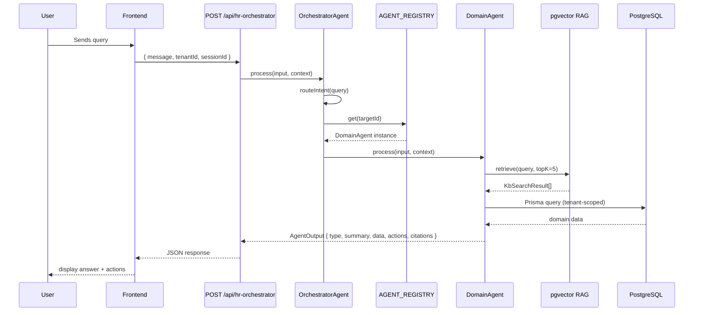
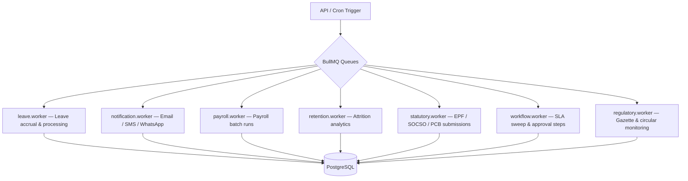
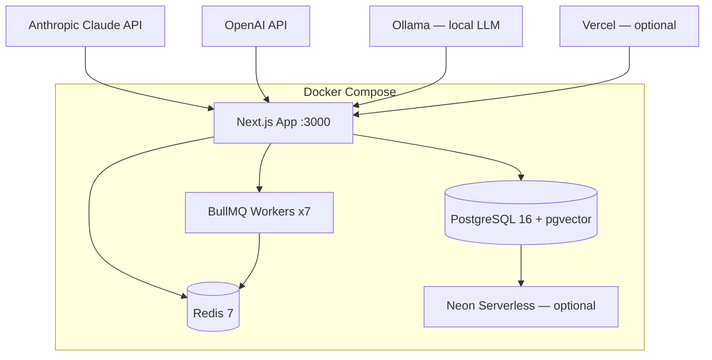

<div align="center">

  

  # AiFWMS — Autonomous Human Resources & Foreign Worker Management System

  <p>
    Enterprise <b>Malaysian HR platform</b> for <b>foreign worker compliance</b>, <b>permit & visa lifecycle</b>,
    <b>payroll</b>, <b>geolocation attendance</b>, <b>autonomous HR orchestration</b>, and <b>ISO/QMS management</b>.
  </p>

  <p>
    <a href="#quick-links">Quick Links</a> ·
    <a href="#getting-started">Getting Started</a> ·
    <a href="#architecture">Architecture</a> ·
    <a href="#security">Security</a>
  </p>

</div>

---

## Badges


---

## Quick Links

- **Quick Start**: [QUICK_START.md](./QUICK_START.md)
- **Architecture**: [docs/ARCHITECTURE.md](./docs/ARCHITECTURE.md)
- **API Analysis**: [docs/api-analysis/README.md](./docs/api-analysis/README.md)
- **Security**: [docs/SECURITY.md](./docs/SECURITY.md)
- **Development Guide**: [docs/DEVELOPMENT.md](./docs/DEVELOPMENT.md)
- **Contributing**: [docs/CONTRIBUTING.md](./docs/CONTRIBUTING.md)
- **Environment Reference**: [docs/ENV_REFERENCE.md](./docs/ENV_REFERENCE.md)
- **FAQ**: [docs/FAQ.md](./docs/FAQ.md)
- **Changelog**: [CHANGELOG.md](./CHANGELOG.md)
- **OpenClaw AI Framework**: [.openclaw/README_AI.md](./.openclaw/README_AI.md)
- **Tech Debt Roadmap**: [docs/tech-debt/PATH_TO_100.md](./docs/tech-debt/PATH_TO_100.md)

---

## Table of Contents

- [Features](#features)
- [Implementation Status](#implementation-status)
- [Products](#products)
- [Tech Stack](#tech-stack)
- [Architecture](#architecture)
- [OpenClaw Agent Framework](#openclaw-agent-framework)
- [Folder Structure](#folder-structure)
- [Getting Started](#getting-started)
- [Environment Variables](#environment-variables)
- [Scripts](#scripts)
- [Security](#security)
- [Internationalization](#internationalization)
- [Deployment](#deployment)
- [Contributing](#contributing)
- [License](#license)

---

## Features

<details>
<summary><h3>OpenClaw Autonomous AI Framework 🤖</h3></summary>

- **50 implemented agents** across 6 tiers — all `.agent.ts` files fully built with Prisma DB queries, RAG retrieval, and collaboration patterns
- **123 skills across 15 categories** — statutory calculation, document processing, compliance, communication, data analysis, case management, workflow automation, orchestration, AI reasoning, continuous improvement (Lean/Six Sigma/Kaizen), immigration & permit, accommodation & EMA, foreign worker lifecycle, advanced analytics, **regulatory intelligence**
- **RAG-enabled knowledge base** — ~130 Malaysian regulatory documents indexed via pgvector; Employment Act 1955, Immigration Act 1959/63, EPF/SOCSO/EIS/PCB/SKBBK/Levy, FOMEMA, JTKSM, LHDN, EMA Act 446, 2026 amendments (P.U. (A) 49/2026 rental cap, gig workers act, PDPA amendments)
- **4-tier memory** (session / episodic / semantic / collaborative) wired to all agents via `BaseAgent`
- **4 collaboration patterns** (sequential / parallel / consensus / supervisory) via EventBus
- **Human-in-the-Loop gates** via `ai_approvals` table for critical decisions (dismissals, permits, compliance)
- **10-step regulatory change pipeline** — gazette monitoring → diff → affected workflows → policy update → notify → recommend → deadlines → migration tasks → impact assessment → KB index refresh
- See [`.openclaw/README_AI.md`](./.openclaw/README_AI.md) for the full framework guide

</details>

<details>
<summary><h3>Core Platform 🧱</h3></summary>

- **Multi-tenant architecture** — tenant ID scoped at every query
- **API-first design** — Next.js App Router + tRPC (66 routers, ~460 procedures) + 27 REST API directories
- **291 Prisma models** — comprehensive HCM, compliance, payroll, immigration, accommodation, QMS, and regulatory intelligence schema
- **pgvector semantic search** — embeddings-backed knowledge retrieval for all AI agents
- **Internationalization** — 11 locales with RTL (Arabic) support
- **Dark/light theme** — CSS-first Tailwind v4 design tokens

</details>

<details>
<summary><h3>Foreign Worker Compliance & Permits 🇲🇾</h3></summary>

- Full 10-stage foreign worker lifecycle: quota → recruitment → pre-departure medical → visa → arrival → FOMEMA → permit registration → deployment → renewal → repatriation
- PLKS/EPLKS, Employment Pass (Cat I/II/III), Professional Visit Pass, Dependent Pass management
- FOMEMA medical screening scheduling, fitness tracking, expiry alerts
- Levy calculation, payment tracking, and quota reconciliation
- Accommodation compliance under EMA Act 446 + 2026 rental cap (RM 150/worker/month)
- eKad/iKad biometric management (2026 mandatory re-enrolment)
- MAPO/ATIPSOM forced-labour compliance checks
- Geolocation-based attendance with geofence verification

</details>

<details>
<summary><h3>Payroll & Accounting 💼</h3></summary>

- Full-cycle payroll with EPF, SOCSO, EIS, PCB/MTD, SKBBK statutory calculations
- Payroll batch run, period locking, payslip PDF generation
- EA Form, CP39, CP8D government submission workflows
- e-Invoice (LHDN MyInvois-compliant, mandatory from Aug 2024)
- Invoice management, delivery orders, credit/debit notes
- Tax calculator, financial reports, government submissions portal

</details>

<details>
<summary><h3>Regulatory Intelligence 🏛️</h3></summary>

- **14 specialized regulatory intelligence agents** (Labour Law, Immigration, Payroll Compliance, Tax, HRD Corp, ESG, Foreign Worker Compliance, Expatriate Compliance, Circular Monitoring, Legal Knowledge, Audit Readiness, Policy Change Detection, Risk Prediction, AI Compliance Copilot)
- **Continuous source monitoring** — polls Federal Gazette, AGC, KESUMA, JIM, LHDN, EPF, PERKESO, HRD Corp, Parliament, and 20+ other trusted portals
- **Versioned legal knowledge graph** — `legal_authorities` + `knowledge_graph_edges` with effective dates and superseded-by tracking
- **Explainable AI** — citation-backed compliance answers with source attribution
- **Regulatory risk scoring** — weighted model from violations, pending changes, and open alerts

</details>

<details>
<summary><h3>Automation & Workflow ⏱️</h3></summary>

- React Flow-based workflow designer (`@xyflow/react`)
- BullMQ job queues — **7 background workers**: leave, notification, payroll, retention, statutory, workflow, **regulatory monitoring**
- QMS integration — ISO 9001 / ISO 27001 compliance workflows
- SOP management — create, approve, publish
- Automation rules engine with trigger/condition/action model

</details>

<details>
<summary><h3>ISO & Quality Management 📋</h3></summary>

- ISO 9001:2015 and ISO 27001:2022 compliance frameworks
- CAPA (Corrective and Preventive Actions) with root cause analysis
- 5 Whys, Fishbone (Ishikawa) diagrams, gap analysis
- Risk assessment matrix, climate risk assessment
- Lean/Six Sigma DMAIC, Kaizen, 5S, Gemba Walk, Value Stream Mapping

</details>

<details>
<summary><h3>HR Operations 👥</h3></summary>

- Full employee lifecycle: onboarding → performance → learning → succession → offboarding
- Leave management with balance tracking and year-end accrual
- Recruitment pipeline with JD management and application stages
- Performance cycles, reviews, and goal tracking
- Industrial relations: union management, collective bargaining, retrenchment (VSS/MSS)
- Health & safety, travel management, workforce planning

</details>

<details>
<summary><h3>Self-Service Portals 🔑</h3></summary>

- **ESS**: Payslips, leave requests, claims, training enrolment, profile management
- **MSS**: Team management, approvals, attendance monitoring, performance reviews

</details>

---

## Implementation Status

Current verified state of the codebase (August 2026):

| Area | Status | Detail |
|---|---|---|
| Application UI + routing | ✅ Complete | 9 products, 11 locales, 300+ pages |
| tRPC API layer | ✅ 66 routers | ~460 procedures; 63% fully DB-backed |
| REST API | ✅ 27 directories | All critical endpoints authenticated |
| **OpenClaw agent implementations** | ✅ **50/50** | All `.agent.ts` files built with full `BaseAgent` interface |
| Agent barrel index | ✅ Complete | `.openclaw/agents/index.ts` — `AGENT_REGISTRY` map |
| Prisma schema | ✅ 291 models | Includes regulatory intelligence models |
| Password security | ✅ Fixed | bcrypt via `lib/server/password.ts` in all 3 auth paths |
| Unauthenticated endpoints | ✅ Fixed | Chat, geolocation, embeddings all session-guarded |
| Regulatory monitoring pipeline | ✅ Complete | Full 10-step pipeline, `regulatory.worker.ts` registered |
| RAG pipeline | ✅ Wired | pgvector + `.openclaw/knowledge/` (130 docs) auto-indexed |
| HR Orchestrator API | ✅ Updated | Routes to `AGENT_REGISTRY`, exposes `GET /api/hr-orchestrator` |
| 4-tier memory architecture | ✅ Wired | Session memory in `BaseAgent`; pgvector for semantic tier |
| Knowledge base (Malaysian laws) | ✅ 130 docs | `loadOpenClawKnowledge()` chunks by heading into pgvector |
| Background workers | ✅ 7 active | Includes `regulatory.worker.ts` with hourly cron |
| Test coverage | ✅ ~70% | Vitest configured; 254 unit tests passing across 22 files |

---

## Products

| Product | Route | Description |
|---|---|---|
| **Dashboard (HR)** | `/dashboard` | HR administration, analytics, workforce management |
| **Accounting** | `/accounting` | Invoices, payroll, tax, e-invoice, government submissions |
| **Automation** | `/automation` | Workflow engine, flow designer, QMS, SOPs, templates |
| **AI Hub** | `/ai` | Chat hub, KB chat, semantic search, HR orchestrator, doc gen |
| **CAPEX** | `/capex` | Assets, projects, budget, ROI, ISO compliance, OPEX |
| **Employees** | `/employees` | Employee management, onboarding, foreign workers, expats |
| **ESS** | `/ess` | Employee self-service — payslips, leave, claims, training |
| **MSS** | `/mss` | Manager self-service — team, approvals, attendance, performance |
| **Integrations** | `/integrations` | Government APIs, third-party connectors, ABAC |

---

## Tech Stack

| Layer | Technology | Version |
|---|---|---|
| **Frontend** | Next.js App Router, React | 16, 19 |
| **Language** | TypeScript | 6 |
| **Styling** | Tailwind CSS + shadcn/ui + Radix UI | 4 |
| **Backend/API** | tRPC, Next.js Route Handlers | 11 |
| **Runtime** | Node.js | 22 |
| **Database** | PostgreSQL + pgvector | 16 |
| **ORM** | Prisma | 7 — 291 models |
| **Auth** | Custom session (jose) + MFA (TOTP) | — |
| **AI Orchestration** | Vercel AI SDK + @ai-sdk/* | — |
| **AI Providers** | OpenAI, Anthropic Claude, Ollama | gpt-4o-mini, claude-3-5-sonnet |
| **Async Jobs** | BullMQ + Redis | 6, 7 — 7 workers |
| **Charts/UX** | Recharts, React Flow, Framer Motion | — |
| **Desktop App** | Electron | WindowDownloader/ |
| **Containers** | Docker / Docker Compose | — |

---

## Architecture

### System Overview

```mermaid
flowchart TD
    App["AiFWMS Full-Stack Application"]

    App --> FE["Frontend Layer"]
    App --> API["API Transport Layer"]
    App --> Services["Business Services Layer"]
    App --> Data["Data Access Layer"]
    App --> Agents["OpenClaw Agent Layer (50 agents)"]

    FE --> Pages["Next.js App Router (9 products)"]
    FE --> Components["React Components + shadcn/ui"]
    FE --> States["Zustand / Context"]

    API --> TRPC["tRPC (66 routers, ~460 procedures)"]
    API --> REST["REST Route Handlers (27 directories)"]
    API --> Validate["Zod Input Validation"]

    Services --> AuthSvc["Auth + MFA (TOTP)"]
    Services --> NotificationSvc["Notification Service"]
    Services --> AISvc["AI Orchestration (EnhancedOrchestrator)"]
    Services --> WorkflowSvc["BullMQ Workers (7)"]
    Services --> RegSvc["Regulatory Intelligence Pipeline"]

    Data --> ORM["Prisma ORM (291 models)"]
    ORM --> DB[("PostgreSQL 16 + pgvector")]
    ORM --> Cache[("Redis 7")]

    Agents --> Registry["AGENT_REGISTRY (50 agents)"]
    Registry --> RAG["pgvector RAG (130 KB docs)"]
    Registry --> Memory["4-Tier Memory"]
    Registry --> EventBus["EventBus (collaboration)"]
```



### OpenClaw Agent Routing



### Regulatory Change Pipeline (10 steps)

```mermaid
graph LR
    S1[1. Detect Change] --> S2[2. Compare Requirements]
    S2 --> S3[3. Identify Affected Workflows]
    S3 --> S4[4. Update Internal Policies]
    S4 --> S5[5. Notify HR & Legal]
    S5 --> S6[6. Recommend Process Changes]
    S6 --> S7[7. Flag Deadlines]
    S7 --> S8[8. Create Migration Tasks]
    S8 --> S9[9. Executive Impact Assessment]
    S9 --> S10[10. Refresh KB Index]
```



Triggered by `regulatory.worker.ts` (hourly cron) → `lib/regulatory/monitor.ts` → `lib/regulatory/change-pipeline.ts`.

### Background Workers



### Deployment



---

## OpenClaw Agent Framework

50 agents across 6 tiers, all implemented in `.openclaw/agents/`. Each extends `BaseAgent` and is registered in `AGENT_REGISTRY`.

### Tier 1 — Core HR (8 agents)

| Agent | ID | Key Skills |
|---|---|---|
| Payroll Agent | `payroll` | EPF, SOCSO, EIS, PCB, overtime, proration, payslips |
| Leave Agent | `leave` | Balances, applications, approvals, encashment |
| Recruitment Agent | `recruitment` | JD creation, pipeline, offers |
| Talent Acquisition Agent | `talent-acquisition` | Sourcing, headcount planning |
| Employee Relations Agent | `employee-relations` | Grievances, disciplinary, DI |
| Industrial Relations Agent | `industrial-relations` | Unions, CBA, retrenchment |
| Learning & Development Agent | `learning-development` | Training, HRDC claims |
| Compensation & Benefits Agent | `compensation-benefits` | Salary bands, market benchmarking |

### Tier 2 — Foreign Worker Specialists (9 agents)

| Agent | ID | Key Skills |
|---|---|---|
| Immigration & Visa Agent | `immigration-visa` | PLKS/EPLKS, quota, eKad, biometrics, 2026 compliance |
| Immigration Agent | `immigration` | Policy guidance, permit types, eligibility |
| Immigration Dept Agent | `immigration-department` | ESD portal, eKad, special passes, overstay |
| Foreign Worker Lifecycle Agent | `foreign-worker-lifecycle` | 10-stage lifecycle orchestration |
| Foreign Worker & Expat Agent | `foreign-worker-expatriate` | FW + expat records, quota, levy |
| Expatriate Agent | `expatriate` | EP, PVP, DP, CP22B, ESD compliance |
| FOMEMA Agent | `fomema` | Medical screening, fitness tracking, expiry alerts |
| Levy Agent | `levy` | Calculation, payment, quota reconciliation |
| Accommodation Agent | `accommodation` | EMA Act 446, 2026 rental cap (RM 150), inspections |

### Tier 3 — Statutory & Compliance (5 agents)

| Agent | ID | Key Skills |
|---|---|---|
| EPF Agent | `epf` | KWSP contributions by age tier |
| PERKESO Agent | `perkeso` | SOCSO + EIS calculation |
| LHDN Agent | `lhdn` | PCB/MTD, e-Invoice, EA Form, CP39 |
| JTKSM Agent | `jtksm` | Labour compliance, inspections, penalties |
| HR Compliance Agent | `compliance` | Multi-regulation audit, risk scoring |

### Tier 4 — Cross-Cutting Intelligence (10 agents)

| Agent | ID | Key Skills |
|---|---|---|
| HR Analytics Agent | `analytics` | Headcount, attendance rate, leave utilisation |
| HR Analytics & AI Agent | `analytics-ai` | Attrition prediction, Lean CI, executive dashboard |
| Audit & Risk Agent | `audit-risk` | CAPA, risk matrix, penalty quantification |
| Audit Readiness Agent | `audit-readiness` | Evidence coverage, regulator-inspection readiness |
| Case Management Agent | `case-management` | SLA enforcement, escalation, audit trail |
| Document Intelligence Agent | `document-intelligence` | OCR, classification, PDF generation |
| Notification & Workflow Agent | `notification-workflow` | Multi-channel notify, SLA alerts, cron reports |
| HR Quality Management Agent | `hr-quality-management` | ISO, DMAIC, Kaizen, 5S, Gemba Walk |
| Training & Competency Agent | `training-competency` | Skills matrix, certification tracking |
| Succession Planning Agent | `succession-planning` | 9-Box grid, HiPo IDP, retention risk |

### Tier 5 — Strategic & AI (3 agents)

| Agent | ID | Key Skills |
|---|---|---|
| Claude AI Agent | `claude` | Anthropic reasoning, RAG, tool calling |
| Ollama Local AI Agent | `ollama` | Offline LLM, data privacy compliance |
| Employer Branding Agent | `employer-branding` | EVP, job ad campaigns |

### Tier 6 — Regulatory Intelligence (14 agents, v3.0.0)

| Agent | ID | Key Skills |
|---|---|---|
| Labour Law Intelligence | `labour-law-intelligence` | EA 1955 monitoring, impact assessment, citations |
| Immigration Intelligence | `immigration-intelligence` | JIM practice directions, visa policy changes |
| Payroll Compliance | `payroll-compliance` | EPF/SOCSO/PCB circular compliance |
| Tax Intelligence | `tax-intelligence` | LHDN e-invoice, PCB schedule changes |
| HRD Corp Compliance | `hrdc-compliance` | 1% levy management, grant claims |
| ESG Reporting | `esg-reporting` | Bursa / ISSB sustainability scoring |
| Foreign Worker Compliance | `foreign-worker-compliance` | FWCMS, MAPO/ATIPSOM obligations |
| Expatriate Compliance | `expatriate-compliance` | EP policy, ESD, CP22B monitoring |
| Circular Monitoring | `circular-monitoring` | Ministry announcements, agency circulars |
| Legal Knowledge | `legal-knowledge` | Versioned knowledge graph, citations |
| Policy Change Detection | `policy-change-detection` | 10-step regulatory change pipeline |
| Risk Prediction | `risk-prediction` | Regulatory risk scoring (0–100) |
| AI Compliance Copilot | `compliance-copilot` | Fan-out to all regulatory agents, unified answer |
| Orchestrator | `orchestrator` | Intent routing, AGENT_REGISTRY dispatch |

---

## Folder Structure

```text
app/                            # Next.js App Router
  [locale]/                     # 11-locale routes
    accounting/ ai/ automation/ capex/ dashboard/
    employees/ ess/ hr/ integrations/ iso/ mss/ opex/
  api/                          # REST route handlers (27 directories)
    ai/                         # chat (auth-guarded), rag, documents
    auth/                       # login, MFA, reset-password, session
    embeddings/ingest/          # document text ingestion (auth-guarded)
    geolocation/                # GPS tracking (auth-guarded)
    hr-orchestrator/            # Multi-agent dispatch (GET + POST)
    regulatory/                 # Regulatory change pipeline API
    notifications/stream/       # SSE real-time notifications
    employees/bulk/             # Bulk import/export
    webhooks/                   # Inbound HMAC + outbound subscriptions
    trpc/                       # tRPC HTTP handler
.openclaw/                      # OpenClaw AI agent framework
  agents/                       # 50 .agent.ts implementations + index.ts
    base.agent.ts               # BaseAgent — memory, RAG, collaboration
    orchestrator.agent.ts       # AGENT_REGISTRY + OrchestratorAgent
    *.agent.ts                  # 48 domain + regulatory agents
  config/
    agent-registry.json         # 50 agents (v3.0.0)
    skills-registry.json        # 123 skills, 15 categories
    orchestrator-config.json    # Autonomous tuning
  docs/                         # AGENTS, SOUL, MEMORY, SKILL, GAP_ANALYSIS, etc.
  knowledge/                    # ~130 Malaysian regulatory markdown docs (22 domains)
  lib/                          # RAG pipeline, embeddings, ML, vector memory
  orchestrator/
    enhanced-orchestrator.ts    # Unified autonomous orchestrator (CAPABILITIES registry)
  plugins/                      # Intent, session, workflow, knowledge, observability
  scripts/                      # embed-all-documents.ts, index-knowledge.ts
components/                     # React UI components
lib/                            # Core server libraries
  ai/                           # AI agents (attrition, OCR, payroll explainer, etc.)
  ahros/                        # Legacy AHROS pipeline (event-bus, execution-engine)
  kb/                           # Knowledge base store
  kb-loader.ts                  # Loads ISO JSON + .openclaw/knowledge/ into pgvector
  orchestrator/                 # Legacy HR orchestrator (kept for compatibility)
  rag.ts                        # pgvector similarity search + Ollama fallback
  regulatory/                   # monitor, change-detector, change-pipeline, citations, etc.
  security/                     # abac, rls, rate-limit, xss, ssrf
  server/
    auth.ts                     # getCurrentSession helper
    password.ts                 # hashPassword / verifyPassword (bcryptjs)
prisma/
  schema.prisma                 # 291 models
  migrations/                   # Database migrations
server/
  routers/                      # 66 tRPC routers
  agents/                       # 20 legacy agent functions (kept for compatibility)
  middleware/                   # ABAC, RLS middleware
workers/                        # BullMQ background workers (7)
  index.ts                      # Entry point — starts all workers + cron jobs
  leave.worker.ts               # Leave accrual & processing
  notification.worker.ts        # Email / SMS / WhatsApp dispatch
  payroll.worker.ts             # Payroll batch execution
  regulatory.worker.ts          # Regulatory source polling (hourly)
  retention.worker.ts           # Retention analytics
  statutory.worker.ts           # EPF / SOCSO / PCB submissions
  workflow.worker.ts            # SLA sweep + workflow execution
services/                       # Domain engines
  audit-engine.ts compliance-scoring-engine.ts
  risk-engine.ts climate-risk-engine.ts corrective-action-engine.ts
WindowDownloader/               # Electron desktop app
```

---

## Getting Started

### Prerequisites

- Node.js 22+
- PostgreSQL 16+ with pgvector extension
- Redis 7+
- Docker & Docker Compose (recommended)

### Quick Start

```bash
# Clone and install
git clone <repo-url>
cd aifwms
npm install

# Database setup
npx prisma generate
npx prisma db push

# Start development server
npm run dev
```

### Docker Compose

```bash
docker-compose up
```

Starts: PostgreSQL (pgvector), Redis, Next.js app, BullMQ workers (all 7).

### Index the Knowledge Base

On first run, index the ~130 Malaysian regulatory documents into pgvector:

```bash
# From .openclaw directory
npm run index-knowledge    # indexes .openclaw/knowledge/ into pgvector
npm run embed-docs         # generates embeddings for all documents
```

Or call `POST /api/kb/ingest?preload=true` from the UI after startup.

See [QUICK_START.md](./QUICK_START.md) for full setup including WindowDownloader and environment configuration.

---

## Environment Variables

| Variable | Description | Required |
|---|---|---|
| `DATABASE_URL` | PostgreSQL connection string | ✅ |
| `NEON_DATABASE_URL` | Neon serverless PostgreSQL (overrides DATABASE_URL) | ⛳ |
| `REDIS_URL` | Redis connection string | ⛳ |
| `OPENAI_API_KEY` | OpenAI API key (`sk-...`) | ⛳ |
| `ANTHROPIC_API_KEY` | Anthropic Claude API key (`sk-ant-...`) | ⛳ |
| `OLLAMA_BASE_URL` | Ollama local server URL (default: `http://localhost:11434`) | ⛳ |
| `JWT_SECRET` | Session signing secret — min 32 chars | ✅ |
| `SECRETS_PROVIDER` | Secrets provider: `env`, `aws`, or `azure` | ⛳ |
| `NEXT_PUBLIC_TENANT_ID` | Default tenant identifier | ⛳ |
| `NEXTAUTH_URL` | App base URL for OIDC callbacks | ⛳ |
| `ENTRA_TENANT_ID` / `ENTRA_CLIENT_ID` / `ENTRA_CLIENT_SECRET` | Microsoft Entra OIDC | ⛳ |
| `GOOGLE_CLIENT_ID` / `GOOGLE_CLIENT_SECRET` | Google OIDC | ⛳ |
| `OKTA_ISSUER` / `OKTA_CLIENT_ID` / `OKTA_CLIENT_SECRET` | Okta OIDC | ⛳ |
| `AUDITOR_EMAIL` | Email for audit/compliance notifications | ⛳ |
| `ANALYZE` | Set to `true` to generate a bundle analysis report | ⛳ |

✅ Required · ⛳ Optional

Copy `.env.example` (project root) to `.env.local` for the full reference with comments.

---

## Scripts

| Script | Command | Description |
|---|---|---|
| Dev server | `npm run dev` | Next.js dev (Turbopack) |
| Production build | `npm run build` | Standalone output |
| Production start | `npm run start` | Run production server |
| Type check | `npm run typecheck` | `tsc --noEmit` |
| Tests | `npm test` | Run all Vitest unit tests |
| Bundle analysis | `npm run analyze` | Build with bundle size report |
| Workers | `npx tsx workers/index.ts` | Start all 7 BullMQ workers |
| Index knowledge | `cd .openclaw && npm run index-knowledge` | Load docs into pgvector |
| Verify routes | `npm run verify:automation-routes` | Validate automation routes |

---

## Security

| Layer | Implementation | Status |
|---|---|---|
| **Password hashing** | bcryptjs (cost factor 12) via `lib/server/password.ts` | ✅ |
| **Authentication** | Custom session (jose JWT) + MFA TOTP (otplib) | ✅ |
| **Authorization** | ABAC (`lib/security/abac.ts`) + RLS (`server/middleware/rls.ts`) | ✅ |
| **Rate limiting** | Redis-backed — login (5/15min), MFA (5/15min) | ✅ |
| **XSS protection** | Input sanitization with dompurify (`lib/security/xss.ts`) | ✅ |
| **SSRF protection** | Outbound request validation (`lib/security/ssrf.ts`) | ✅ |
| **AI endpoint auth** | `/api/ai/chat`, `/api/geolocation`, `/api/embeddings/ingest` all session-guarded | ✅ |
| **HMAC webhooks** | Biometric terminal events verified via HMAC signature | ✅ |
| **Secrets management** | AWS Secrets Manager / Azure Key Vault / env vars | ✅ |
| **Audit trail** | Immutable event log on all write operations | ✅ |
| **Tenant isolation** | Every Prisma query scoped by `tenantId` | ✅ |

MFA is enforced for privileged roles: `Super_Admin`, `HR_Director`, `Payroll_Manager`, `HR_Manager`, `Compliance_Officer`.

See [docs/SECURITY.md](./docs/SECURITY.md) for full security documentation.

---

## Internationalization

| Feature | Detail |
|---|---|
| **Locales** | 11 languages: en, bn, ne, ms, zh, es, id, th, ph, vt, ar |
| **RTL** | Arabic (`ar`) — full bidirectional layout |
| **Namespaces** | common, validation, errors, notifications, email |
| **Formatting** | Locale-specific date, number, currency |
| **Engine** | `i18next` + `react-i18next`, file-based loading |

---

## Deployment

### Docker (Recommended)

```bash
# Production build
docker build --target production -t aifwms:latest .

# Full stack (app + postgres + redis + workers)
docker-compose up
```

### Vercel

Deploy the Next.js app to Vercel. Set all environment variables in the Vercel dashboard. Workers must run separately (e.g., a dedicated Node.js container or Railway).

### Neon (Serverless PostgreSQL)

```bash
export NEON_DATABASE_URL="postgresql://..."
docker-compose up
```

---

## Development Workflow

1. Create a feature branch from `main`
2. Write TypeScript with existing domain conventions — no new frameworks without discussion
3. Keep tenant scoping and ABAC checks intact on all new routes
4. Run `npm run typecheck` before committing
5. Open a PR — ensure build passes

### Code Style

- **Domain services** in `lib/` — business logic separate from UI
- **Zod schemas** for all API input validation
- **tRPC** for client↔server communication — avoid raw `fetch()` for internal calls
- **`'use client'` boundary** — server-only logic stays in server paths
- **Tailwind CSS v4** — CSS-first with `@theme` tokens

---

## Contributing

1. Fork the repository
2. Create a feature branch
3. Follow patterns in `docs/DEVELOPMENT.md`
4. Preserve tenant isolation, RBAC safety, and audit compliance
5. Add i18n translations for any new UI strings
6. Submit a PR with typecheck and build passing

---

## Changelog

See [CHANGELOG.md](./CHANGELOG.md) for sprint progress, fixes, and versioning.

---

## FAQ

See [docs/FAQ.md](./docs/FAQ.md) for answers on multi-tenancy, AI providers, i18n, workers, ISO/QMS, CAPEX/OPEX, local development, and security.

---

## License

PROPRIETARY — see [LICENSE](./LICENSE).

---

## Acknowledgements

**Next.js** · **React** · **TypeScript** · **Tailwind CSS** · **shadcn/ui** · **Radix UI** · **Prisma** · **tRPC** · **Vercel AI SDK** · **Anthropic Claude** · **OpenAI** · **Ollama** · **BullMQ** · **Redis** · **PostgreSQL** · **pgvector** · **Framer Motion** · **Recharts** · **React Flow** · **i18next** · **Zustand** · **Zod** · **Electron** · **bcryptjs** · **jose**
