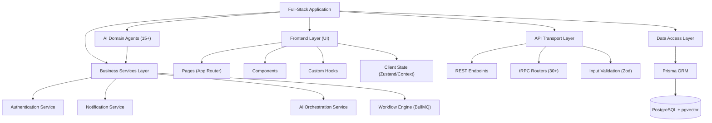
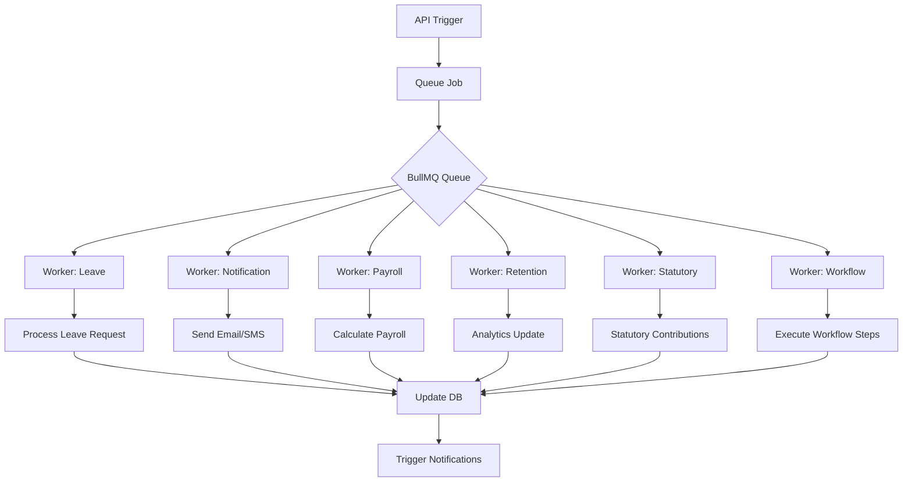
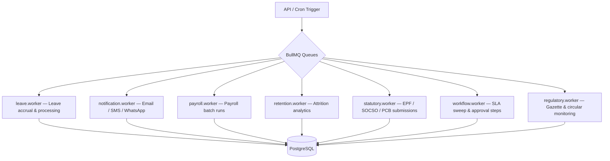

<<<<<<< HEAD

<!--
  AiFWMS — AI Foreign Worker Management System
  Enterprise-grade README generated from repository analysis.
  Note: No features were invented; uncertain items are marked with > **TODO:** Verify implementation.
-->
<div align="center">

  <!-- Logo placeholder -->
  

  # AiFWMS — AI Foreign Worker Management System

  <p>
    Enterprise <b>Malaysian HR platform</b> for <b>foreign worker compliance</b>, <b>permit & visa lifecycle</b>, <b>payroll</b>, <b>geolocation attendance</b>, <b>AI-powered HR orchestration</b>, and <b>ISO/QMS management</b>.
=======
<div align="center">

  

  # AiFWMS — Autonomous Human Resources & Foreign Worker Management System

  <p>
    Enterprise <b>Malaysian HR platform</b> for <b>foreign worker compliance</b>, <b>permit & visa lifecycle</b>,
    <b>payroll</b>, <b>geolocation attendance</b>, <b>autonomous HR orchestration</b>, and <b>ISO/QMS management</b>.
>>>>>>> 2cd618c (refactor: update existing files)
  </p>

  <p>
    <a href="#quick-links">Quick Links</a> ·
    <a href="#getting-started">Getting Started</a> ·
    <a href="#architecture">Architecture</a> ·
    <a href="#security">Security</a>
  </p>

</div>

---

## Badges

<<<<<<< HEAD
### Framework & Quality

=======
>>>>>>> 2cd618c (refactor: update existing files)


<<<<<<< HEAD

=======


>>>>>>> 2cd618c (refactor: update existing files)

---

## Quick Links

<<<<<<< HEAD
- **Documentation**: `docs/` directory
- **Quick Start**: [docs/QUICK_START.md](./docs/QUICK_START.md)
- **Architecture**: [docs/ARCHITECTURE.md](./docs/ARCHITECTURE.md)
- **API Overview**: [docs/API_OVERVIEW.md](./docs/API_OVERVIEW.md)
- **Development Guide**: [docs/DEVELOPMENT.md](./docs/DEVELOPMENT.md)
- **Security**: [docs/SECURITY.md](./docs/SECURITY.md)
- **FAQ**: [docs/FAQ.md](./docs/FAQ.md)
- **Changelog**: [CHANGELOG.md](./CHANGELOG.md)
=======
- **Quick Start**: [QUICK_START.md](./QUICK_START.md)
- **Architecture**: [docs/ARCHITECTURE.md](./docs/ARCHITECTURE.md)
- **API Analysis**: [docs/api-analysis/README.md](./docs/api-analysis/README.md)
- **Security**: [docs/SECURITY.md](./docs/SECURITY.md)
- **Development Guide**: [docs/DEVELOPMENT.md](./docs/DEVELOPMENT.md)
- **Contributing**: [docs/CONTRIBUTING.md](./docs/CONTRIBUTING.md)
- **Environment Reference**: [docs/ENV_REFERENCE.md](./docs/ENV_REFERENCE.md)
- **FAQ**: [docs/FAQ.md](./docs/FAQ.md)
- **Changelog**: [CHANGELOG.md](./CHANGELOG.md)
- **OpenClaw AI Framework**: [.openclaw/README_AI.md](./.openclaw/README_AI.md)
- **Tech Debt Roadmap**: [docs/tech-debt/PATH_TO_100.md](./docs/tech-debt/PATH_TO_100.md)
>>>>>>> 2cd618c (refactor: update existing files)

---

## Table of Contents

<<<<<<< HEAD
- [AiFWMS — AI Foreign Worker Management System](#aifwms--ai-foreign-worker-management-system)
  - [Badges](#badges)
  - [Quick Links](#quick-links)
  - [Screenshots](#screenshots)
  - [Features](#features)
  - [Products](#products)
  - [Tech Stack](#tech-stack)
  - [Architecture](#architecture)
    - [System Overview](#system-overview)
    - [AI Orchestration](#ai-orchestration)
    - [Background Workers](#background-workers)
    - [Deployment Architecture](#deployment-architecture)
  - [Folder Structure](#folder-structure)
  - [Getting Started](#getting-started)
  - [Environment Variables](#environment-variables)
  - [Scripts](#scripts)
  - [Development Workflow](#development-workflow)
  - [Code Style](#code-style)
  - [Internationalization](#internationalization)
  - [Performance](#performance)
  - [Security](#security)
  - [Testing](#testing)
  - [Deployment](#deployment)
  - [Roadmap](#roadmap)
  - [Contributing](#contributing)
  - [Changelog](#changelog)
  - [FAQ](#faq)
  - [License](#license)
  - [Acknowledgements](#acknowledgements)

---

## Screenshots

> Screenshot paths reference images in `./public/images/`. Replace with actual images once available.

| Page | Screenshot |
|---|---|
| Landing Page |  |
| Dashboard Live Location |  |
| Permit & Immigration |  |
| Desktop CMD Installation |  |
| Flow Design |  |
| MSS Dashboard |  |
| Compliance Management |  |
| Accounting |  |
| Data Governance |  |
| Learning & Development |  |

---

## Features

<details>
<summary><h3>Core Platform 🧱</h3></summary>

- **Multi-tenant architecture** driven by tenant ID scoping
- **API-first design** — Next.js App Router + tRPC layer (30+ routers) + domain services
- **AI orchestration** — Multi-agent HR orchestrator with domain-specific agents
- **Prisma-based PostgreSQL persistence** with pgvector support for semantic search
- **Internationalization** — 9 locales with RTL support
- **Theme system** — Dark/light mode with next-themes
=======
- [Features](#features)
- [Implementation Status](#implementation-status)
- [Products](#products)
- [Tech Stack](#tech-stack)
- [Architecture](#architecture)
- [OpenClaw Agent Framework](#openclaw-agent-framework)
- [Folder Structure](#folder-structure)
- [Getting Started](#getting-started)
- [Environment Variables](#environment-variables)
- [Scripts](#scripts)
- [Security](#security)
- [Internationalization](#internationalization)
- [Deployment](#deployment)
- [Contributing](#contributing)
- [License](#license)

---

## Features

<details>
<summary><h3>OpenClaw Autonomous AI Framework 🤖</h3></summary>

- **50 implemented agents** across 6 tiers — all `.agent.ts` files fully built with Prisma DB queries, RAG retrieval, and collaboration patterns
- **123 skills across 15 categories** — statutory calculation, document processing, compliance, communication, data analysis, case management, workflow automation, orchestration, AI reasoning, continuous improvement (Lean/Six Sigma/Kaizen), immigration & permit, accommodation & EMA, foreign worker lifecycle, advanced analytics, **regulatory intelligence**
- **RAG-enabled knowledge base** — ~130 Malaysian regulatory documents indexed via pgvector; Employment Act 1955, Immigration Act 1959/63, EPF/SOCSO/EIS/PCB/SKBBK/Levy, FOMEMA, JTKSM, LHDN, EMA Act 446, 2026 amendments (P.U. (A) 49/2026 rental cap, gig workers act, PDPA amendments)
- **4-tier memory** (session / episodic / semantic / collaborative) wired to all agents via `BaseAgent`
- **4 collaboration patterns** (sequential / parallel / consensus / supervisory) via EventBus
- **Human-in-the-Loop gates** via `ai_approvals` table for critical decisions (dismissals, permits, compliance)
- **10-step regulatory change pipeline** — gazette monitoring → diff → affected workflows → policy update → notify → recommend → deadlines → migration tasks → impact assessment → KB index refresh
- See [`.openclaw/README_AI.md`](./.openclaw/README_AI.md) for the full framework guide
>>>>>>> 2cd618c (refactor: update existing files)

</details>

<details>
<<<<<<< HEAD
<summary><h3>Foreign Worker Compliance & Permits 🇲🇾</h3></summary>

- Foreign worker permit & visa lifecycle management
- FOMEMA medical screening scheduling and expiration alerts
- Levy calculator and payment tracking
- Immigration compliance tracking
- Accommodation inspection and compliance
- Geolocation-based attendance verification
=======
<summary><h3>Core Platform 🧱</h3></summary>

- **Multi-tenant architecture** — tenant ID scoped at every query
- **API-first design** — Next.js App Router + tRPC (66 routers, ~460 procedures) + 27 REST API directories
- **291 Prisma models** — comprehensive HCM, compliance, payroll, immigration, accommodation, QMS, and regulatory intelligence schema
- **pgvector semantic search** — embeddings-backed knowledge retrieval for all AI agents
- **Internationalization** — 11 locales with RTL (Arabic) support
- **Dark/light theme** — CSS-first Tailwind v4 design tokens
>>>>>>> 2cd618c (refactor: update existing files)

</details>

<details>
<<<<<<< HEAD
<summary><h3>Payroll & Accounting 💼</h3></summary>

- Payroll processing with EPF, SOCSO, EIS, PCB statutory calculations
- Payroll calculator with real-time projections
- Tax calculator
- E-invoice (LHDN-compliant)
- Invoice management (create, track, export)
- Delivery orders, credit/debit notes
- Financial reports and analytics
- Government submissions portal
=======
<summary><h3>Foreign Worker Compliance & Permits 🇲🇾</h3></summary>

- Full 10-stage foreign worker lifecycle: quota → recruitment → pre-departure medical → visa → arrival → FOMEMA → permit registration → deployment → renewal → repatriation
- PLKS/EPLKS, Employment Pass (Cat I/II/III), Professional Visit Pass, Dependent Pass management
- FOMEMA medical screening scheduling, fitness tracking, expiry alerts
- Levy calculation, payment tracking, and quota reconciliation
- Accommodation compliance under EMA Act 446 + 2026 rental cap (RM 150/worker/month)
- eKad/iKad biometric management (2026 mandatory re-enrolment)
- MAPO/ATIPSOM forced-labour compliance checks
- Geolocation-based attendance with geofence verification
>>>>>>> 2cd618c (refactor: update existing files)

</details>

<details>
<summary><h3>Payroll & Accounting 💼</h3></summary>

<<<<<<< HEAD
- **Multi-agent HR orchestrator** — Routes queries to 15+ domain-specific agents
- **Provider-agnostic AI** — OpenAI, Anthropic Claude, and Ollama support
- **RAG pipeline** — Knowledge retrieval + context assembly with pgvector embeddings
- **Streaming chat endpoints** for live assistant experience
- **Document generator** — AI-powered document creation
- **Semantic search** across knowledge base
=======
- Full-cycle payroll with EPF, SOCSO, EIS, PCB/MTD, SKBBK statutory calculations
- Payroll batch run, period locking, payslip PDF generation
- EA Form, CP39, CP8D government submission workflows
- e-Invoice (LHDN MyInvois-compliant, mandatory from Aug 2024)
- Invoice management, delivery orders, credit/debit notes
- Tax calculator, financial reports, government submissions portal
>>>>>>> 2cd618c (refactor: update existing files)

</details>

<details>
<<<<<<< HEAD
<summary><h3>Automation & Workflow ⏱️</h3></summary>

- **React Flow-based workflow designer** (`@xyflow/react`)
- **Workflow engine** — Execute and monitor automated workflows
- **BullMQ job queues** — 6 background workers for async processing
- **QMS integration** — Link workflows to ISO 9001 / ISO 27001 compliance
- **SOP management** — Create, approve, and publish standard operating procedures
- **Flow templates** — Reusable workflow templates

</details>

<details>
<summary><h3>ISO & Quality Management 📋</h3></summary>

- ISO 9001 and ISO 27001 compliance frameworks
- Audit checklist creation and management
- CAPA (Corrective and Preventive Actions) workflow
- 5 Whys root cause analysis
- Fishbone (Ishikawa) diagrams
- Gap analysis and compliance scoring
- Risk assessment matrix
- Climate risk assessment

</details>

<details>
<summary><h3>CAPEX & OPEX 💰</h3></summary>

- **CAPEX**: Asset tracking, project management, budget planning, ROI analysis
- **OPEX (Operational Excellence)**:
  - **Lean** — Waste reduction and process optimization
  - **Six Sigma** — DMAIC methodology and statistical process control
  - **Kaizen** — Continuous improvement tracking
  - **Kanban** — Visual workflow management
  - Analytics and performance dashboards
=======
<summary><h3>Regulatory Intelligence 🏛️</h3></summary>

- **14 specialized regulatory intelligence agents** (Labour Law, Immigration, Payroll Compliance, Tax, HRD Corp, ESG, Foreign Worker Compliance, Expatriate Compliance, Circular Monitoring, Legal Knowledge, Audit Readiness, Policy Change Detection, Risk Prediction, AI Compliance Copilot)
- **Continuous source monitoring** — polls Federal Gazette, AGC, KESUMA, JIM, LHDN, EPF, PERKESO, HRD Corp, Parliament, and 20+ other trusted portals
- **Versioned legal knowledge graph** — `legal_authorities` + `knowledge_graph_edges` with effective dates and superseded-by tracking
- **Explainable AI** — citation-backed compliance answers with source attribution
- **Regulatory risk scoring** — weighted model from violations, pending changes, and open alerts
>>>>>>> 2cd618c (refactor: update existing files)

</details>

<details>
<summary><h3>Automation & Workflow ⏱️</h3></summary>

<<<<<<< HEAD
- Attendance tracking with geolocation verification
- Real-time worker location monitoring
- Geofence-based compliance checking
- Attendance history and reporting
- API endpoint: `/api/geolocation/*`
=======
- React Flow-based workflow designer (`@xyflow/react`)
- BullMQ job queues — **7 background workers**: leave, notification, payroll, retention, statutory, workflow, **regulatory monitoring**
- QMS integration — ISO 9001 / ISO 27001 compliance workflows
- SOP management — create, approve, publish
- Automation rules engine with trigger/condition/action model
>>>>>>> 2cd618c (refactor: update existing files)

</details>

<details>
<<<<<<< HEAD
<summary><h3>HR Operations 👥</h3></summary>

- Employee lifecycle management (onboarding to offboarding)
- Leave management with balance tracking
- Recruitment pipeline
- Performance management and reviews
- Learning & development with LMS integration
- Succession planning
- Employee relations and industrial relations case management
- Health & safety incident tracking
- Travel management
- Workforce planning and forecasting
- Document management with PDF generation
=======
<summary><h3>ISO & Quality Management 📋</h3></summary>

- ISO 9001:2015 and ISO 27001:2022 compliance frameworks
- CAPA (Corrective and Preventive Actions) with root cause analysis
- 5 Whys, Fishbone (Ishikawa) diagrams, gap analysis
- Risk assessment matrix, climate risk assessment
- Lean/Six Sigma DMAIC, Kaizen, 5S, Gemba Walk, Value Stream Mapping

</details>

<details>
<summary><h3>HR Operations 👥</h3></summary>

- Full employee lifecycle: onboarding → performance → learning → succession → offboarding
- Leave management with balance tracking and year-end accrual
- Recruitment pipeline with JD management and application stages
- Performance cycles, reviews, and goal tracking
- Industrial relations: union management, collective bargaining, retrenchment (VSS/MSS)
- Health & safety, travel management, workforce planning
>>>>>>> 2cd618c (refactor: update existing files)

</details>

<details>
<summary><h3>Self-Service Portals 🔑</h3></summary>

<<<<<<< HEAD
- **ESS (Employee Self-Service)**: Payslips, leave requests, claims, training, profile
- **MSS (Manager Self-Service)**: Team management, approvals, attendance, performance
=======
- **ESS**: Payslips, leave requests, claims, training enrolment, profile management
- **MSS**: Team management, approvals, attendance monitoring, performance reviews
>>>>>>> 2cd618c (refactor: update existing files)

</details>

---

<<<<<<< HEAD
## Products

The application is organized into **9 distinct products**, each with its own routes and navigation:
=======
## Implementation Status

Current verified state of the codebase (August 2026):

| Area | Status | Detail |
|---|---|---|
| Application UI + routing | ✅ Complete | 9 products, 11 locales, 300+ pages |
| tRPC API layer | ✅ 66 routers | ~460 procedures; 63% fully DB-backed |
| REST API | ✅ 27 directories | All critical endpoints authenticated |
| **OpenClaw agent implementations** | ✅ **50/50** | All `.agent.ts` files built with full `BaseAgent` interface |
| Agent barrel index | ✅ Complete | `.openclaw/agents/index.ts` — `AGENT_REGISTRY` map |
| Prisma schema | ✅ 291 models | Includes regulatory intelligence models |
| Password security | ✅ Fixed | bcrypt via `lib/server/password.ts` in all 3 auth paths |
| Unauthenticated endpoints | ✅ Fixed | Chat, geolocation, embeddings all session-guarded |
| Regulatory monitoring pipeline | ✅ Complete | Full 10-step pipeline, `regulatory.worker.ts` registered |
| RAG pipeline | ✅ Wired | pgvector + `.openclaw/knowledge/` (130 docs) auto-indexed |
| HR Orchestrator API | ✅ Updated | Routes to `AGENT_REGISTRY`, exposes `GET /api/hr-orchestrator` |
| 4-tier memory architecture | ✅ Wired | Session memory in `BaseAgent`; pgvector for semantic tier |
| Knowledge base (Malaysian laws) | ✅ 130 docs | `loadOpenClawKnowledge()` chunks by heading into pgvector |
| Background workers | ✅ 7 active | Includes `regulatory.worker.ts` with hourly cron |
| Test coverage | ✅ ~70% | Vitest configured; 254 unit tests passing across 22 files |

---

## Products
>>>>>>> 2cd618c (refactor: update existing files)

| Product | Route | Description |
|---|---|---|
| **Dashboard (HR)** | `/dashboard` | HR administration, analytics, workforce management |
| **Accounting** | `/accounting` | Invoices, payroll, tax, e-invoice, government submissions |
| **Automation** | `/automation` | Workflow engine, flow designer, QMS, SOPs, templates |
| **AI Hub** | `/ai` | Chat hub, KB chat, semantic search, HR orchestrator, doc gen |
| **CAPEX** | `/capex` | Assets, projects, budget, ROI, ISO compliance, OPEX |
| **Employees** | `/employees` | Employee management, onboarding, foreign workers, expats |
| **ESS** | `/ess` | Employee self-service — payslips, leave, claims, training |
| **MSS** | `/mss` | Manager self-service — team, approvals, attendance, performance |
| **Integrations** | `/integrations` | Government APIs, third-party connectors, ABAC |

---

## Tech Stack

| Layer | Technology | Version |
|---|---|---|
<<<<<<< HEAD
| **Frontend** | Next.js 16 (App Router), React 19 | UI + routing |
| **Language** | TypeScript 6 | Type-safe enterprise codebase |
| **Styling** | Tailwind CSS 4 + shadcn/ui + Radix UI | Design system and responsive UI |
| **Backend/API** | Next.js Route Handlers + tRPC 11 | API layer and type-safe contracts |
| **Runtime** | Node.js 22 | Server/runtime execution |
| **Database** | PostgreSQL 16 + Prisma 7 | Persistence and relational model |
| **Vector/AI Search** | pgvector + embeddings libs | Semantic retrieval for RAG |
| **Auth** | NextAuth.js + MFA (TOTP) | Authentication and session management |
| **AI Orchestration** | Vercel AI SDK + @ai-sdk/* + LangChain | Streaming LLM + provider abstraction |
| **AI Providers** | OpenAI, Anthropic Claude, Ollama | Multi-provider AI support |
| **Async Jobs** | BullMQ 5 + Redis 7 | Background processing and workflows |
| **Charts/UX** | Recharts, React Flow, Framer Motion | Enterprise dashboards and visual workflows |
| **Virtualization** | @dnd-kit | Drag-and-drop interactions |
| **Containers** | Docker / Docker Compose | Reproducible deployments |
| **Desktop App** | Electron (WindowDownloader/) | Offline desktop client |
=======
| **Frontend** | Next.js App Router, React | 16, 19 |
| **Language** | TypeScript | 6 |
| **Styling** | Tailwind CSS + shadcn/ui + Radix UI | 4 |
| **Backend/API** | tRPC, Next.js Route Handlers | 11 |
| **Runtime** | Node.js | 22 |
| **Database** | PostgreSQL + pgvector | 16 |
| **ORM** | Prisma | 7 — 291 models |
| **Auth** | Custom session (jose) + MFA (TOTP) | — |
| **AI Orchestration** | Vercel AI SDK + @ai-sdk/* | — |
| **AI Providers** | OpenAI, Anthropic Claude, Ollama | gpt-4o-mini, claude-3-5-sonnet |
| **Async Jobs** | BullMQ + Redis | 6, 7 — 7 workers |
| **Charts/UX** | Recharts, React Flow, Framer Motion | — |
| **Desktop App** | Electron | WindowDownloader/ |
| **Containers** | Docker / Docker Compose | — |
>>>>>>> 2cd618c (refactor: update existing files)

---

## Architecture

### System Overview

```mermaid
flowchart TD
    App["AiFWMS Full-Stack Application"]

    App --> FE["Frontend Layer"]
    App --> API["API Transport Layer"]
    App --> Services["Business Services Layer"]
    App --> Data["Data Access Layer"]
    App --> Agents["OpenClaw Agent Layer (50 agents)"]

    FE --> Pages["Next.js App Router (9 products)"]
    FE --> Components["React Components + shadcn/ui"]
    FE --> States["Zustand / Context"]

    API --> TRPC["tRPC (66 routers, ~460 procedures)"]
    API --> REST["REST Route Handlers (27 directories)"]
    API --> Validate["Zod Input Validation"]

    Services --> AuthSvc["Auth + MFA (TOTP)"]
    Services --> NotificationSvc["Notification Service"]
    Services --> AISvc["AI Orchestration (EnhancedOrchestrator)"]
    Services --> WorkflowSvc["BullMQ Workers (7)"]
    Services --> RegSvc["Regulatory Intelligence Pipeline"]

    Data --> ORM["Prisma ORM (291 models)"]
    ORM --> DB[("PostgreSQL 16 + pgvector")]
    ORM --> Cache[("Redis 7")]

    Agents --> Registry["AGENT_REGISTRY (50 agents)"]
    Registry --> RAG["pgvector RAG (130 KB docs)"]
    Registry --> Memory["4-Tier Memory"]
    Registry --> EventBus["EventBus (collaboration)"]
```

<<<<<<< HEAD

The following diagram illustrates the high-level architecture of AiFWMS, showing the separation between frontend, API transport, business services, and data access layers. The system is designed with clear boundaries to ensure maintainability, testability, and security.



### AI Orchestration

The AI orchestration engine is a core component of AiFWMS. It uses a multi‑agent architecture to handle a wide variety of HR‑related queries. The sequence diagram below shows how a user query flows through the system: from the frontend, through the orchestrator API, to the agent router, and finally to a domain‑specific agent that interacts with large language models (LLMs), retrieval‑augmented generation (RAG), and external tools.
=======



### OpenClaw Agent Routing
>>>>>>> 2cd618c (refactor: update existing files)

```mermaid
sequenceDiagram
    participant User
    participant Frontend
<<<<<<< HEAD
    participant OrchestratorAPI
    participant Orchestrator
    participant AgentRouter
    participant DomainAgent
    participant LLM
    participant RAG
    participant Tools

    User->>Frontend: Sends query
    Frontend->>OrchestratorAPI: POST /api/ai/orchestrate
    OrchestratorAPI->>Orchestrator: routeQuery(query)
    Orchestrator->>Orchestrator: Identify intent
    Orchestrator->>AgentRouter: selectAgent(intent)
    AgentRouter-->>Orchestrator: DomainAgent instance
    Orchestrator->>DomainAgent: process(query)
    DomainAgent->>RAG: retrieveContext(query)
    RAG-->>DomainAgent: relevant documents
    DomainAgent->>LLM: prompt + context
    LLM-->>DomainAgent: generated response
    DomainAgent->>Tools: (if needed) call tools
    Tools-->>DomainAgent: tool results
    DomainAgent-->>Orchestrator: final response
    Orchestrator-->>OrchestratorAPI: response
    OrchestratorAPI-->>Frontend: streaming/response
    Frontend-->>User: display answer
```

### Background Workers

Time‑consuming or recurring tasks are offloaded to background workers managed by BullMQ and Redis. Six dedicated workers handle leave processing, notifications, payroll, retention analytics, statutory contributions, and workflow execution. The diagram below illustrates how jobs are enqueued, processed, and how results are persisted and notifications are triggered.



### Deployment Architecture

The application is containerized using Docker and orchestrated with Docker Compose. The deployment stack includes the Next.js app, a PostgreSQL database with pgvector extension, Redis for caching and queue management, and BullMQ workers. The diagram also shows optional integration with Neon serverless PostgreSQL and external AI APIs.
=======
    participant OrchestratorAPI as POST /api/hr-orchestrator
    participant OrchestratorAgent
    participant AGENT_REGISTRY
    participant DomainAgent
    participant pgvector as pgvector RAG
    participant DB as PostgreSQL

    User->>Frontend: Sends query
    Frontend->>OrchestratorAPI: { message, tenantId, sessionId }
    OrchestratorAPI->>OrchestratorAgent: process(input, context)
    OrchestratorAgent->>OrchestratorAgent: routeIntent(query)
    OrchestratorAgent->>AGENT_REGISTRY: get(targetId)
    AGENT_REGISTRY-->>OrchestratorAgent: DomainAgent instance
    OrchestratorAgent->>DomainAgent: process(input, context)
    DomainAgent->>pgvector: retrieve(query, topK=5)
    pgvector-->>DomainAgent: KbSearchResult[]
    DomainAgent->>DB: Prisma query (tenant-scoped)
    DB-->>DomainAgent: domain data
    DomainAgent-->>OrchestratorAPI: AgentOutput { type, summary, data, actions, citations }
    OrchestratorAPI-->>Frontend: JSON response
    Frontend-->>User: display answer + actions
```

### Regulatory Change Pipeline (10 steps)

```mermaid
graph LR
    S1[1. Detect Change] --> S2[2. Compare Requirements]
    S2 --> S3[3. Identify Affected Workflows]
    S3 --> S4[4. Update Internal Policies]
    S4 --> S5[5. Notify HR & Legal]
    S5 --> S6[6. Recommend Process Changes]
    S6 --> S7[7. Flag Deadlines]
    S7 --> S8[8. Create Migration Tasks]
    S8 --> S9[9. Executive Impact Assessment]
    S9 --> S10[10. Refresh KB Index]
```



Triggered by `regulatory.worker.ts` (hourly cron) → `lib/regulatory/monitor.ts` → `lib/regulatory/change-pipeline.ts`.

### Background Workers



### Deployment
>>>>>>> 2cd618c (refactor: update existing files)

```mermaid
graph TD
    subgraph "Docker Compose"
<<<<<<< HEAD
        A[Next.js App] --> B[(PostgreSQL + pgvector)]
        A --> C[(Redis)]
        A --> D[BullMQ Workers]
        D --> C
        B --> E[Neon Serverless]
    end
    F[External AI APIs] --> A
    G[Vercel] --> A
```

For additional diagrams covering security, i18n, and more detailed component interactions, see [docs/ARCHITECTURE.md](./docs/ARCHITECTURE.md).
=======
        App[Next.js App :3000] --> PG[(PostgreSQL 16 + pgvector)]
        App --> Redis[(Redis 7)]
        App --> Workers[BullMQ Workers x7]
        Workers --> Redis
        PG --> Neon[Neon Serverless — optional]
    end
    Claude[Anthropic Claude API] --> App
    OpenAI[OpenAI API] --> App
    Ollama[Ollama — local LLM] --> App
    Vercel[Vercel — optional] --> App
```

---

## OpenClaw Agent Framework

50 agents across 6 tiers, all implemented in `.openclaw/agents/`. Each extends `BaseAgent` and is registered in `AGENT_REGISTRY`.

### Tier 1 — Core HR (8 agents)

| Agent | ID | Key Skills |
|---|---|---|
| Payroll Agent | `payroll` | EPF, SOCSO, EIS, PCB, overtime, proration, payslips |
| Leave Agent | `leave` | Balances, applications, approvals, encashment |
| Recruitment Agent | `recruitment` | JD creation, pipeline, offers |
| Talent Acquisition Agent | `talent-acquisition` | Sourcing, headcount planning |
| Employee Relations Agent | `employee-relations` | Grievances, disciplinary, DI |
| Industrial Relations Agent | `industrial-relations` | Unions, CBA, retrenchment |
| Learning & Development Agent | `learning-development` | Training, HRDC claims |
| Compensation & Benefits Agent | `compensation-benefits` | Salary bands, market benchmarking |

### Tier 2 — Foreign Worker Specialists (9 agents)

| Agent | ID | Key Skills |
|---|---|---|
| Immigration & Visa Agent | `immigration-visa` | PLKS/EPLKS, quota, eKad, biometrics, 2026 compliance |
| Immigration Agent | `immigration` | Policy guidance, permit types, eligibility |
| Immigration Dept Agent | `immigration-department` | ESD portal, eKad, special passes, overstay |
| Foreign Worker Lifecycle Agent | `foreign-worker-lifecycle` | 10-stage lifecycle orchestration |
| Foreign Worker & Expat Agent | `foreign-worker-expatriate` | FW + expat records, quota, levy |
| Expatriate Agent | `expatriate` | EP, PVP, DP, CP22B, ESD compliance |
| FOMEMA Agent | `fomema` | Medical screening, fitness tracking, expiry alerts |
| Levy Agent | `levy` | Calculation, payment, quota reconciliation |
| Accommodation Agent | `accommodation` | EMA Act 446, 2026 rental cap (RM 150), inspections |

### Tier 3 — Statutory & Compliance (5 agents)

| Agent | ID | Key Skills |
|---|---|---|
| EPF Agent | `epf` | KWSP contributions by age tier |
| PERKESO Agent | `perkeso` | SOCSO + EIS calculation |
| LHDN Agent | `lhdn` | PCB/MTD, e-Invoice, EA Form, CP39 |
| JTKSM Agent | `jtksm` | Labour compliance, inspections, penalties |
| HR Compliance Agent | `compliance` | Multi-regulation audit, risk scoring |

### Tier 4 — Cross-Cutting Intelligence (10 agents)

| Agent | ID | Key Skills |
|---|---|---|
| HR Analytics Agent | `analytics` | Headcount, attendance rate, leave utilisation |
| HR Analytics & AI Agent | `analytics-ai` | Attrition prediction, Lean CI, executive dashboard |
| Audit & Risk Agent | `audit-risk` | CAPA, risk matrix, penalty quantification |
| Audit Readiness Agent | `audit-readiness` | Evidence coverage, regulator-inspection readiness |
| Case Management Agent | `case-management` | SLA enforcement, escalation, audit trail |
| Document Intelligence Agent | `document-intelligence` | OCR, classification, PDF generation |
| Notification & Workflow Agent | `notification-workflow` | Multi-channel notify, SLA alerts, cron reports |
| HR Quality Management Agent | `hr-quality-management` | ISO, DMAIC, Kaizen, 5S, Gemba Walk |
| Training & Competency Agent | `training-competency` | Skills matrix, certification tracking |
| Succession Planning Agent | `succession-planning` | 9-Box grid, HiPo IDP, retention risk |

### Tier 5 — Strategic & AI (3 agents)

| Agent | ID | Key Skills |
|---|---|---|
| Claude AI Agent | `claude` | Anthropic reasoning, RAG, tool calling |
| Ollama Local AI Agent | `ollama` | Offline LLM, data privacy compliance |
| Employer Branding Agent | `employer-branding` | EVP, job ad campaigns |

### Tier 6 — Regulatory Intelligence (14 agents, v3.0.0)

| Agent | ID | Key Skills |
|---|---|---|
| Labour Law Intelligence | `labour-law-intelligence` | EA 1955 monitoring, impact assessment, citations |
| Immigration Intelligence | `immigration-intelligence` | JIM practice directions, visa policy changes |
| Payroll Compliance | `payroll-compliance` | EPF/SOCSO/PCB circular compliance |
| Tax Intelligence | `tax-intelligence` | LHDN e-invoice, PCB schedule changes |
| HRD Corp Compliance | `hrdc-compliance` | 1% levy management, grant claims |
| ESG Reporting | `esg-reporting` | Bursa / ISSB sustainability scoring |
| Foreign Worker Compliance | `foreign-worker-compliance` | FWCMS, MAPO/ATIPSOM obligations |
| Expatriate Compliance | `expatriate-compliance` | EP policy, ESD, CP22B monitoring |
| Circular Monitoring | `circular-monitoring` | Ministry announcements, agency circulars |
| Legal Knowledge | `legal-knowledge` | Versioned knowledge graph, citations |
| Policy Change Detection | `policy-change-detection` | 10-step regulatory change pipeline |
| Risk Prediction | `risk-prediction` | Regulatory risk scoring (0–100) |
| AI Compliance Copilot | `compliance-copilot` | Fan-out to all regulatory agents, unified answer |
| Orchestrator | `orchestrator` | Intent routing, AGENT_REGISTRY dispatch |
>>>>>>> 2cd618c (refactor: update existing files)

---

## Folder Structure

```text
<<<<<<< HEAD
app/                          # Next.js App Router
  [locale]/                   # Locale-first routes (9 languages)
    accounting/               # Accounting product
    ai/                       # AI hub product
    automation/               # Automation product
    capex/                    # CAPEX product
    dashboard/                # HR dashboard product
    employees/                # Employee management
    ess/                      # Employee self-service
    hr/                       # HR operations
    integrations/             # Third-party integrations
    iso/                      # ISO/QMS management
    login/                    # Authentication pages
    mss/                      # Manager self-service
    opex/                     # Operational excellence
  api/                        # API route handlers
    ai/                       # AI endpoints (chat, rag, reason, documents)
    auth/                     # Authentication endpoints
    geolocation/              # Attendance tracking endpoints
    hr-orchestrator/          # Multi-agent AI orchestrator
    iso/                      # ISO/QMS endpoints
    kb/                       # Knowledge base endpoints
    sops/                     # SOP management endpoints
    trpc/                     # tRPC HTTP handler
    webhooks/                 # External webhook receivers
components/                   # React components
  ui/                         # shadcn/ui primitives
  ai-elements/                # AI chat UI components
  charts/                     # Chart components (Recharts)
  dashboard-sidebar/          # Sidebar navigation
  features/                   # Domain-specific feature components
  i18n/                       # Internationalization components
  landing/                    # Landing page components
  layout/                     # Layout components
  platform/                   # Product platform components
config/                       # Application configuration
  navigation.ts               # Product navigation definitions
  products.ts                 # Product registry
  sidebar.ts                  # Sidebar configuration
  server-env.ts               # Server environment validation
docs/                         # Documentation
hooks/                        # Custom React hooks
  useAI.ts                    # AI interaction hooks
  useAuth.ts                  # Authentication hooks
  useTranslation.ts           # i18n hooks
  useDashboard.ts             # Dashboard data hooks
  usePayroll.ts               # Payroll hooks
  # ... 40+ domain-specific hooks
i18n/                         # Internationalization
  config.ts                   # Locale configuration (9 locales)
  locales/                    # Translation files
  I18nProvider.tsx            # i18n provider
lib/                          # Core libraries
  ai/                         # AI agents and tools
  orchestrator/               # HR orchestrator logic
  security/                   # ABAC, RLS, rate-limit, SSRF, XSS
  queues/                     # BullMQ queue configuration
  secrets/                    # Secrets management (env/AWS/Azure)
  prisma.ts                   # Database client
  trpc.ts                     # tRPC client
  # ... domain services
prisma/                       # Database schema and migrations
  schema.prisma               # Prisma schema
  migrations/                 # Database migrations
scripts/                      # Utility scripts
  check-automation-routes.mjs # Route verification
  locale-report.mjs           # Locale coverage report
  validate-locales.mjs        # Locale validation
server/                       # Server-side code
  api/routers/                # tRPC API routers
  routers/                    # Additional tRPC routers
  middleware/                 # ABAC, RLS middleware
  agents/                     # AI domain agents
services/                     # Domain services
  audit-engine.ts             # Audit trail engine
  compliance-scoring-engine.ts# Compliance scoring
  risk-engine.ts              # Risk assessment
  climate-risk-engine.ts      # Climate risk
  corrective-action-engine.ts # CAPA engine
styles/                       # CSS files
  globals.css                 # Tailwind v4 imports
  theme.css                   # Design tokens
types/                        # TypeScript type definitions
utils/                        # Utility functions
workers/                      # BullMQ background workers
  leave.worker.ts             # Leave processing
  notification.worker.ts      # Notification dispatch
  payroll.worker.ts           # Payroll execution
  retention.worker.ts         # Retention analytics
  statutory.worker.ts         # Statutory contributions
  workflow.worker.ts          # Workflow execution
WindowDownloader/             # Electron desktop app
  electron/                   # Electron main process
  src/                        # React renderer
=======
app/                            # Next.js App Router
  [locale]/                     # 11-locale routes
    accounting/ ai/ automation/ capex/ dashboard/
    employees/ ess/ hr/ integrations/ iso/ mss/ opex/
  api/                          # REST route handlers (27 directories)
    ai/                         # chat (auth-guarded), rag, documents
    auth/                       # login, MFA, reset-password, session
    embeddings/ingest/          # document text ingestion (auth-guarded)
    geolocation/                # GPS tracking (auth-guarded)
    hr-orchestrator/            # Multi-agent dispatch (GET + POST)
    regulatory/                 # Regulatory change pipeline API
    notifications/stream/       # SSE real-time notifications
    employees/bulk/             # Bulk import/export
    webhooks/                   # Inbound HMAC + outbound subscriptions
    trpc/                       # tRPC HTTP handler
.openclaw/                      # OpenClaw AI agent framework
  agents/                       # 50 .agent.ts implementations + index.ts
    base.agent.ts               # BaseAgent — memory, RAG, collaboration
    orchestrator.agent.ts       # AGENT_REGISTRY + OrchestratorAgent
    *.agent.ts                  # 48 domain + regulatory agents
  config/
    agent-registry.json         # 50 agents (v3.0.0)
    skills-registry.json        # 123 skills, 15 categories
    orchestrator-config.json    # Autonomous tuning
  docs/                         # AGENTS, SOUL, MEMORY, SKILL, GAP_ANALYSIS, etc.
  knowledge/                    # ~130 Malaysian regulatory markdown docs (22 domains)
  lib/                          # RAG pipeline, embeddings, ML, vector memory
  orchestrator/
    enhanced-orchestrator.ts    # Unified autonomous orchestrator (CAPABILITIES registry)
  plugins/                      # Intent, session, workflow, knowledge, observability
  scripts/                      # embed-all-documents.ts, index-knowledge.ts
components/                     # React UI components
lib/                            # Core server libraries
  ai/                           # AI agents (attrition, OCR, payroll explainer, etc.)
  ahros/                        # Legacy AHROS pipeline (event-bus, execution-engine)
  kb/                           # Knowledge base store
  kb-loader.ts                  # Loads ISO JSON + .openclaw/knowledge/ into pgvector
  orchestrator/                 # Legacy HR orchestrator (kept for compatibility)
  rag.ts                        # pgvector similarity search + Ollama fallback
  regulatory/                   # monitor, change-detector, change-pipeline, citations, etc.
  security/                     # abac, rls, rate-limit, xss, ssrf
  server/
    auth.ts                     # getCurrentSession helper
    password.ts                 # hashPassword / verifyPassword (bcryptjs)
prisma/
  schema.prisma                 # 291 models
  migrations/                   # Database migrations
server/
  routers/                      # 66 tRPC routers
  agents/                       # 20 legacy agent functions (kept for compatibility)
  middleware/                   # ABAC, RLS middleware
workers/                        # BullMQ background workers (7)
  index.ts                      # Entry point — starts all workers + cron jobs
  leave.worker.ts               # Leave accrual & processing
  notification.worker.ts        # Email / SMS / WhatsApp dispatch
  payroll.worker.ts             # Payroll batch execution
  regulatory.worker.ts          # Regulatory source polling (hourly)
  retention.worker.ts           # Retention analytics
  statutory.worker.ts           # EPF / SOCSO / PCB submissions
  workflow.worker.ts            # SLA sweep + workflow execution
services/                       # Domain engines
  audit-engine.ts compliance-scoring-engine.ts
  risk-engine.ts climate-risk-engine.ts corrective-action-engine.ts
WindowDownloader/               # Electron desktop app
>>>>>>> 2cd618c (refactor: update existing files)
```

---

## Getting Started

### Prerequisites

- Node.js 22+
<<<<<<< HEAD
- PostgreSQL 16+ with pgvector
=======
- PostgreSQL 16+ with pgvector extension
>>>>>>> 2cd618c (refactor: update existing files)
- Redis 7+
- Docker & Docker Compose (recommended)

### Quick Start

```bash
# Clone and install
git clone <repo-url>
<<<<<<< HEAD
cd fwms
=======
cd aifwms
>>>>>>> 2cd618c (refactor: update existing files)
npm install

# Database setup
npx prisma generate
npx prisma db push

# Start development server
npm run dev
```

### Docker Compose

```bash
docker-compose up
```

<<<<<<< HEAD
Starts: PostgreSQL (pgvector), Redis, Next.js app, BullMQ workers.

See [docs/QUICK_START.md](./docs/QUICK_START.md) for detailed setup instructions including individual worker startup, WindowDownloader, and environment configuration.
=======
Starts: PostgreSQL (pgvector), Redis, Next.js app, BullMQ workers (all 7).

### Index the Knowledge Base

On first run, index the ~130 Malaysian regulatory documents into pgvector:

```bash
# From .openclaw directory
npm run index-knowledge    # indexes .openclaw/knowledge/ into pgvector
npm run embed-docs         # generates embeddings for all documents
```

Or call `POST /api/kb/ingest?preload=true` from the UI after startup.

See [QUICK_START.md](./QUICK_START.md) for full setup including WindowDownloader and environment configuration.
>>>>>>> 2cd618c (refactor: update existing files)

---

## Environment Variables

| Variable | Description | Required |
|---|---|---|
| `DATABASE_URL` | PostgreSQL connection string | ✅ |
| `NEON_DATABASE_URL` | Neon serverless PostgreSQL (overrides DATABASE_URL) | ⛳ |
<<<<<<< HEAD
| `OPENAI_API_KEY` | OpenAI API key for LLM features | ⛳ |
| `ANTHROPIC_API_KEY` | Anthropic Claude API key | ⛳ |
| `REDIS_URL` | Redis connection string | ⛳ |
| `SECRETS_PROVIDER` | Secrets provider (`env`, `aws`, `azure`) | ⛳ |
| `NEXT_PUBLIC_TENANT_ID` | Tenant identifier | ⛳ |

✅ Required · ⛳ Optional (see [docs/QUICK_START.md](./docs/QUICK_START.md) for full list)
=======
| `REDIS_URL` | Redis connection string | ⛳ |
| `OPENAI_API_KEY` | OpenAI API key (`sk-...`) | ⛳ |
| `ANTHROPIC_API_KEY` | Anthropic Claude API key (`sk-ant-...`) | ⛳ |
| `OLLAMA_BASE_URL` | Ollama local server URL (default: `http://localhost:11434`) | ⛳ |
| `JWT_SECRET` | Session signing secret — min 32 chars | ✅ |
| `SECRETS_PROVIDER` | Secrets provider: `env`, `aws`, or `azure` | ⛳ |
| `NEXT_PUBLIC_TENANT_ID` | Default tenant identifier | ⛳ |
| `NEXTAUTH_URL` | App base URL for OIDC callbacks | ⛳ |
| `ENTRA_TENANT_ID` / `ENTRA_CLIENT_ID` / `ENTRA_CLIENT_SECRET` | Microsoft Entra OIDC | ⛳ |
| `GOOGLE_CLIENT_ID` / `GOOGLE_CLIENT_SECRET` | Google OIDC | ⛳ |
| `OKTA_ISSUER` / `OKTA_CLIENT_ID` / `OKTA_CLIENT_SECRET` | Okta OIDC | ⛳ |
| `AUDITOR_EMAIL` | Email for audit/compliance notifications | ⛳ |
| `ANALYZE` | Set to `true` to generate a bundle analysis report | ⛳ |

✅ Required · ⛳ Optional

Copy `.env.example` (project root) to `.env.local` for the full reference with comments.
>>>>>>> 2cd618c (refactor: update existing files)

---

## Scripts

| Script | Command | Description |
|---|---|---|
<<<<<<< HEAD
| Dev Server | `npm run dev` | Start Next.js dev server (Turbopack) |
| Production Build | `npm run build` | Build production artifacts (standalone) |
| Production Start | `npm run start` | Run production server |
| Type Check | `npm run typecheck` | Run `tsc --noEmit` |
| Verify Routes | `npm run verify:automation-routes` | Validate automation routes |

---

## Development Workflow

1. Create a feature branch
2. Implement changes with TypeScript + existing domain conventions
3. Ensure tenant scoping and security checks remain intact
4. Run `npm run typecheck` to verify type safety
5. Open a Pull Request
6. See [docs/DEVELOPMENT.md](./docs/DEVELOPMENT.md) for detailed guidance

---

## Code Style

- **Domain services** in `lib/` — keep business logic separate from UI
- **Zod schemas** for validation — defined in `lib/schemas.ts`
- **tRPC** for client-server communication — avoid raw `fetch()`
- **Server-only logic** out of client components — use `'use client'` boundary
- **Tailwind CSS v4** — CSS-first configuration with `@theme` tokens
- **ES2023 target** with `bundler` module resolution

---

## Internationalization

| Feature | Details |
|---|---|
| **Locales** | 11 languages (en, ms, zh, es, id, th, ph, vt, bn, ne, ar) |
| **RTL Support** | Arabic (`ar`) with full bidirectional layout |
| **Translation Namespaces** | common, validation, errors, notifications, email |
| **Formatting** | Locale-specific date, number, and currency formatting |
| **Implementation** | `i18next` + `react-i18next` with file-based translation loading |

---

## Performance

- **Streaming responses** for AI endpoints to reduce perceived latency
- **Tenant-scoped queries** to minimize result sets
- **Standalone output** for optimal production Docker images
- **Turbopack** for fast development builds
- **Redis caching** for queue and session management
- **Memoization** in React components (Framer Motion, useMemo)
=======
| Dev server | `npm run dev` | Next.js dev (Turbopack) |
| Production build | `npm run build` | Standalone output |
| Production start | `npm run start` | Run production server |
| Type check | `npm run typecheck` | `tsc --noEmit` |
| Tests | `npm test` | Run all Vitest unit tests |
| Bundle analysis | `npm run analyze` | Build with bundle size report |
| Workers | `npx tsx workers/index.ts` | Start all 7 BullMQ workers |
| Index knowledge | `cd .openclaw && npm run index-knowledge` | Load docs into pgvector |
| Verify routes | `npm run verify:automation-routes` | Validate automation routes |
>>>>>>> 2cd618c (refactor: update existing files)

---

## Security

<<<<<<< HEAD
| Layer | Implementation |
|---|---|
| **Authentication** | NextAuth.js + MFA (TOTP via otplib) |
| **Authorization** | ABAC (`lib/security/abac.ts`) + RLS middleware (`server/middleware/rls.ts`) |
| **Rate Limiting** | Configurable rate limiter (`lib/security/rate-limit.ts`) |
| **XSS Protection** | Input sanitization with dompurify (`lib/security/xss.ts`) |
| **SSRF Protection** | Outbound request validation (`lib/security/ssrf.ts`) |
| **Secrets Management** | AWS Secrets Manager / Azure Key Vault / Environment variables |
| **Audit Trail** | Event logging and querying (`/dashboard/audit-trail`) |

See [docs/SECURITY.md](./docs/SECURITY.md) for detailed security documentation.

---

## Testing

- **Unit tests**: Co-located with source files (*.test.ts)
- **Integration tests**: Located in `tests/` directory
- **tRPC router tests**: Available for key routers
- **Testing libraries**: Vitest configured for WindowDownloader
=======
| Layer | Implementation | Status |
|---|---|---|
| **Password hashing** | bcryptjs (cost factor 12) via `lib/server/password.ts` | ✅ |
| **Authentication** | Custom session (jose JWT) + MFA TOTP (otplib) | ✅ |
| **Authorization** | ABAC (`lib/security/abac.ts`) + RLS (`server/middleware/rls.ts`) | ✅ |
| **Rate limiting** | Redis-backed — login (5/15min), MFA (5/15min) | ✅ |
| **XSS protection** | Input sanitization with dompurify (`lib/security/xss.ts`) | ✅ |
| **SSRF protection** | Outbound request validation (`lib/security/ssrf.ts`) | ✅ |
| **AI endpoint auth** | `/api/ai/chat`, `/api/geolocation`, `/api/embeddings/ingest` all session-guarded | ✅ |
| **HMAC webhooks** | Biometric terminal events verified via HMAC signature | ✅ |
| **Secrets management** | AWS Secrets Manager / Azure Key Vault / env vars | ✅ |
| **Audit trail** | Immutable event log on all write operations | ✅ |
| **Tenant isolation** | Every Prisma query scoped by `tenantId` | ✅ |

MFA is enforced for privileged roles: `Super_Admin`, `HR_Director`, `Payroll_Manager`, `HR_Manager`, `Compliance_Officer`.

See [docs/SECURITY.md](./docs/SECURITY.md) for full security documentation.

---

## Internationalization

| Feature | Detail |
|---|---|
| **Locales** | 11 languages: en, bn, ne, ms, zh, es, id, th, ph, vt, ar |
| **RTL** | Arabic (`ar`) — full bidirectional layout |
| **Namespaces** | common, validation, errors, notifications, email |
| **Formatting** | Locale-specific date, number, currency |
| **Engine** | `i18next` + `react-i18next`, file-based loading |
>>>>>>> 2cd618c (refactor: update existing files)

---

## Deployment

### Docker (Recommended)

```bash
# Production build
docker build --target production -t aifwms:latest .

<<<<<<< HEAD
# Run with Docker Compose
=======
# Full stack (app + postgres + redis + workers)
>>>>>>> 2cd618c (refactor: update existing files)
docker-compose up
```

### Vercel

<<<<<<< HEAD
- Compatible with Vercel deployment for Next.js
- Configure environment variables in Vercel dashboard
- AI runtime compatible with Node.js runtime
=======
Deploy the Next.js app to Vercel. Set all environment variables in the Vercel dashboard. Workers must run separately (e.g., a dedicated Node.js container or Railway).
>>>>>>> 2cd618c (refactor: update existing files)

### Neon (Serverless PostgreSQL)

```bash
<<<<<<< HEAD
# Set Neon connection string
export NEON_DATABASE_URL="postgresql://..."

# Start stack
=======
export NEON_DATABASE_URL="postgresql://..."
>>>>>>> 2cd618c (refactor: update existing files)
docker-compose up
```

---

<<<<<<< HEAD
## Roadmap

The project follows a milestone-based sprint model. See:
- [CHANGELOG.md](./CHANGELOG.md) for detailed progress

### Current Status

- **Sprint 1** — Build Recovery & Technical Stabilization (IN PROGRESS)
- **Sprint 2** — AiFWMS Core Completion
- **Sprint 3** — Compliance & Automation Enhancements
- **Sprint 4** — ISO/QMS Integration
=======
## Development Workflow

1. Create a feature branch from `main`
2. Write TypeScript with existing domain conventions — no new frameworks without discussion
3. Keep tenant scoping and ABAC checks intact on all new routes
4. Run `npm run typecheck` before committing
5. Open a PR — ensure build passes

### Code Style

- **Domain services** in `lib/` — business logic separate from UI
- **Zod schemas** for all API input validation
- **tRPC** for client↔server communication — avoid raw `fetch()` for internal calls
- **`'use client'` boundary** — server-only logic stays in server paths
- **Tailwind CSS v4** — CSS-first with `@theme` tokens
>>>>>>> 2cd618c (refactor: update existing files)

---

## Contributing

1. Fork the repository
2. Create a feature branch
<<<<<<< HEAD
3. Follow existing patterns in `docs/`
4. Submit a PR
5. Ensure typecheck and build pass

### Contribution Principles

- Preserve tenant isolation and RBAC safety
- Never bypass tRPC contracts
- Keep server-only logic in server paths
- Maintain audit/compliance alignment
- Add i18n translations for new UI strings
=======
3. Follow patterns in `docs/DEVELOPMENT.md`
4. Preserve tenant isolation, RBAC safety, and audit compliance
5. Add i18n translations for any new UI strings
6. Submit a PR with typecheck and build passing
>>>>>>> 2cd618c (refactor: update existing files)

---

## Changelog

See [CHANGELOG.md](./CHANGELOG.md) for sprint progress, fixes, and versioning.

---

## FAQ

<<<<<<< HEAD
See [docs/FAQ.md](./docs/FAQ.md) for answers to common questions about:
- Multi-tenancy, AI providers, i18n, workers, ISO/QMS, CAPEX/OPEX
- Local development, troubleshooting, and security
=======
See [docs/FAQ.md](./docs/FAQ.md) for answers on multi-tenancy, AI providers, i18n, workers, ISO/QMS, CAPEX/OPEX, local development, and security.
>>>>>>> 2cd618c (refactor: update existing files)

---

## License

<<<<<<< HEAD
<<<<<<< HEAD
PROPRIETARY — see [LICENSE](./LICENSE).
=======
PROPRIETARY — see `LICENSE`.
>>>>>>> 7b8345c (docs: updated)
=======
PROPRIETARY — see [LICENSE](./LICENSE).
>>>>>>> 2cd618c (refactor: update existing files)

---

## Acknowledgements

<<<<<<< HEAD
- **Next.js** & **React** — Web framework and UI library
- **TypeScript** — Type-safe development
- **Tailwind CSS** + **shadcn/ui** + **Radix UI** — Design system
- **Prisma** — Database ORM
- **tRPC** — Type-safe API layer
- **Vercel AI SDK** — AI integration framework
- **BullMQ** — Queue and job processing
- **Redis** — In-memory data store
- **PostgreSQL** + **pgvector** — Database and vector search
- **Framer Motion** — Animation library
- **Recharts** — Charting library
- **React Flow** — Workflow visualization
- **i18next** — Internationalization framework
- **Zustand** — State management
- **Zod** — Schema validation
- **Electron** — Desktop application framework
- **Open Source Community** — All contributors and dependency maintainers
=======
**Next.js** · **React** · **TypeScript** · **Tailwind CSS** · **shadcn/ui** · **Radix UI** · **Prisma** · **tRPC** · **Vercel AI SDK** · **Anthropic Claude** · **OpenAI** · **Ollama** · **BullMQ** · **Redis** · **PostgreSQL** · **pgvector** · **Framer Motion** · **Recharts** · **React Flow** · **i18next** · **Zustand** · **Zod** · **Electron** · **bcryptjs** · **jose**
>>>>>>> 2cd618c (refactor: update existing files)
