<div align="center">

  <!-- Logo placeholder -->
  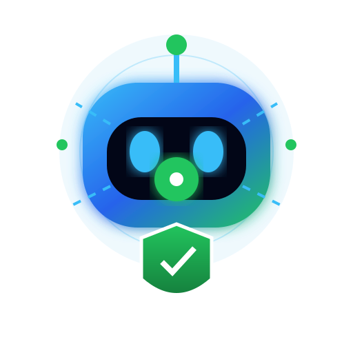

  # AiFWMS — AI Foreign Worker Management System

  <p>
    Enterprise <b>Malaysian HR platform</b> for <b>foreign worker compliance</b>, <b>permit & visa lifecycle</b>, <b>payroll</b>, <b>geolocation attendance</b>, <b>AI-powered HR orchestration</b>, and <b>ISO/QMS management</b>.
  </p>

  <p>
    <a href="#quick-links">Quick Links</a> ·
    <a href="#getting-started">Getting Started</a> ·
    <a href="#architecture">Architecture</a> ·
    <a href="#security">Security</a>
  </p>

</div>

---

## Badges

### Framework & Quality


---

## Quick Links

- **Documentation**: `docs/` directory
- **Quick Start**: [docs/QUICK_START.md](./docs/QUICK_START.md)
- **Architecture**: [docs/ARCHITECTURE.md](./docs/ARCHITECTURE.md)
- **API Overview**: [docs/API_OVERVIEW.md](./docs/API_OVERVIEW.md)
- **Development Guide**: [docs/DEVELOPMENT.md](./docs/DEVELOPMENT.md)
- **Security**: [docs/SECURITY.md](./docs/SECURITY.md)
- **FAQ**: [docs/FAQ.md](./docs/FAQ.md)
- **Changelog**: [CHANGELOG.md](./CHANGELOG.md)

---

## Table of Contents

- [AiFWMS — AI Foreign Worker Management System](#aifwms--ai-foreign-worker-management-system)
  - [Badges](#badges)
  - [Quick Links](#quick-links)
  - [Screenshots](#screenshots)
  - [Features](#features)
  - [Products](#products)
  - [Tech Stack](#tech-stack)
  - [Architecture](#architecture)
    - [System Overview](#system-overview)
    - [AI Orchestration](#ai-orchestration)
    - [Background Workers](#background-workers)
    - [Deployment Architecture](#deployment-architecture)
  - [Folder Structure](#folder-structure)
  - [Getting Started](#getting-started)
  - [Environment Variables](#environment-variables)
  - [Scripts](#scripts)
  - [Development Workflow](#development-workflow)
  - [Code Style](#code-style)
  - [Internationalization](#internationalization)
  - [Performance](#performance)
  - [Security](#security)
  - [Testing](#testing)
  - [Deployment](#deployment)
  - [Roadmap](#roadmap)
  - [Contributing](#contributing)
  - [Changelog](#changelog)
  - [FAQ](#faq)
  - [License](#license)
  - [Acknowledgements](#acknowledgements)

---

## Screenshots

> Screenshot paths reference images in `./public/images/`. Replace with actual images once available.

| Page | Screenshot |
|---|---|
| Landing Page | 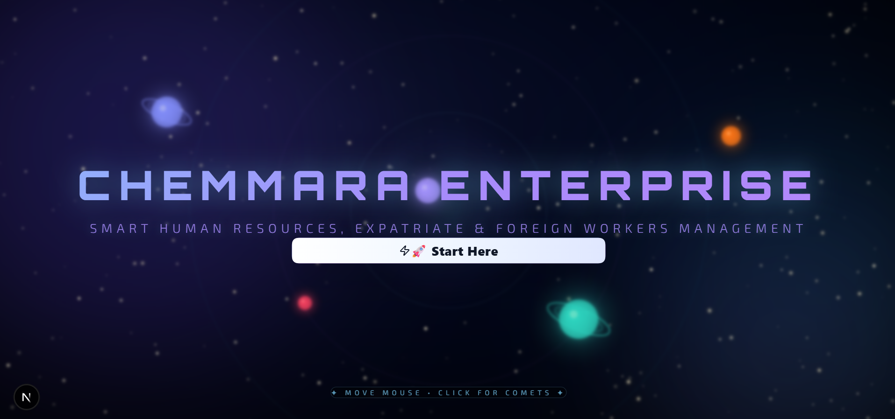 |
| Dashboard Live Location | 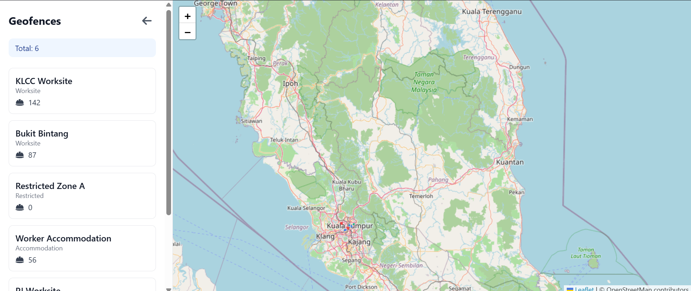 |
| Permit & Immigration | 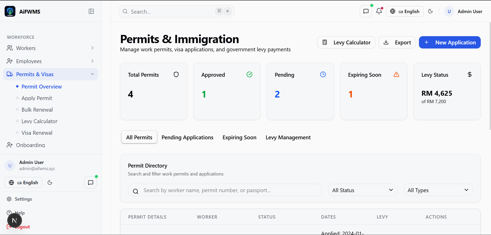 |
| Desktop CMD Installation | 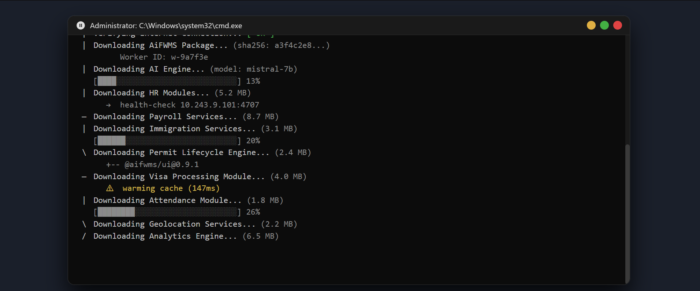 |
| Flow Design | 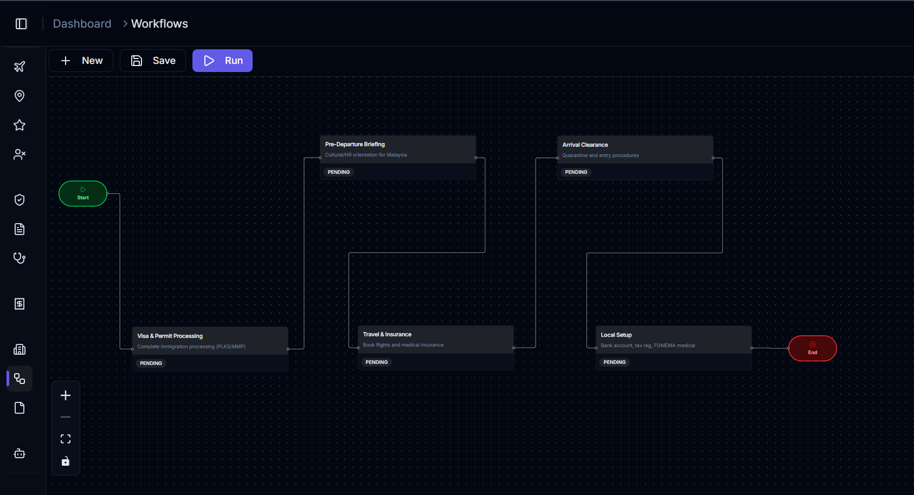 |
| MSS Dashboard | 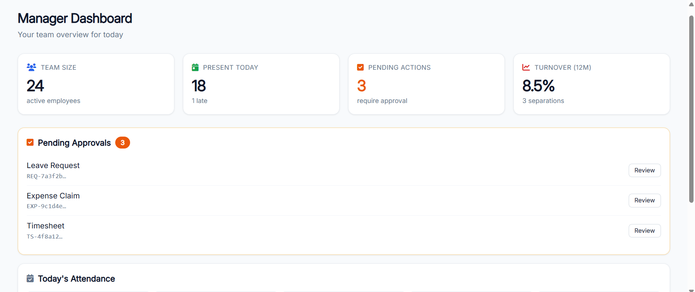 |
| Compliance Management |  |
| Accounting | 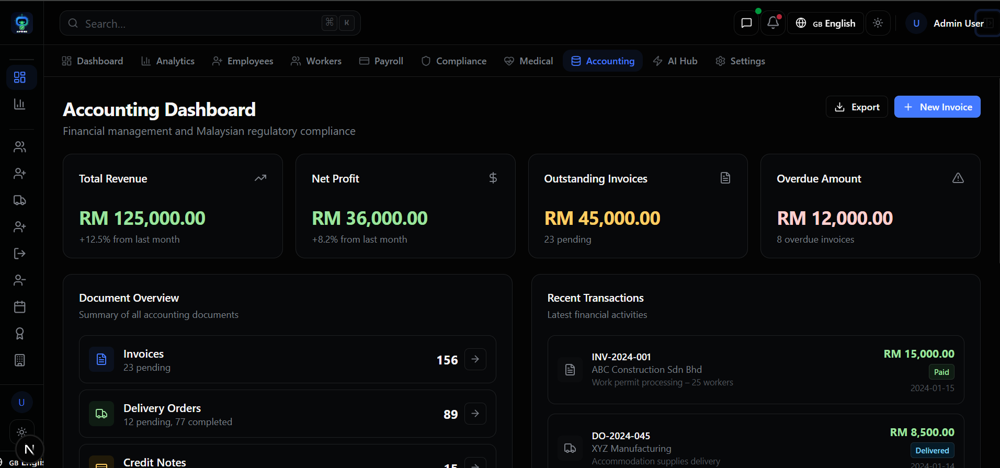 |
| Data Governance | 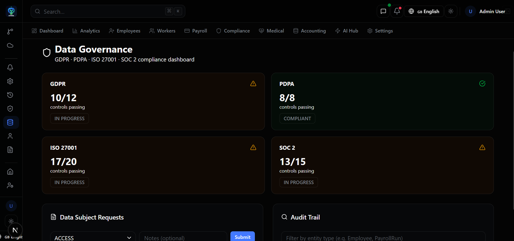 |
| Learning & Development | 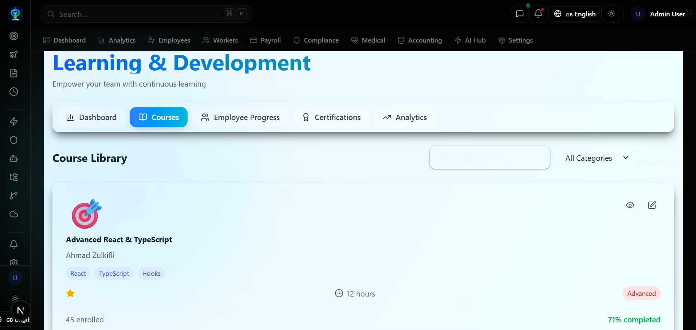 |

---

## Features

<details>
<summary><h3>Core Platform 🧱</h3></summary>

- **Multi-tenant architecture** driven by tenant ID scoping
- **API-first design** — Next.js App Router + tRPC layer (30+ routers) + domain services
- **AI orchestration** — Multi-agent HR orchestrator with domain-specific agents
- **Prisma-based PostgreSQL persistence** with pgvector support for semantic search
- **Internationalization** — 9 locales with RTL support
- **Theme system** — Dark/light mode with next-themes

</details>

<details>
<summary><h3>Foreign Worker Compliance & Permits 🇲🇾</h3></summary>

- Foreign worker permit & visa lifecycle management
- FOMEMA medical screening scheduling and expiration alerts
- Levy calculator and payment tracking
- Immigration compliance tracking
- Accommodation inspection and compliance
- Geolocation-based attendance verification

</details>

<details>
<summary><h3>Payroll & Accounting 💼</h3></summary>

- Payroll processing with EPF, SOCSO, EIS, PCB statutory calculations
- Payroll calculator with real-time projections
- Tax calculator
- E-invoice (LHDN-compliant)
- Invoice management (create, track, export)
- Delivery orders, credit/debit notes
- Financial reports and analytics
- Government submissions portal

</details>

<details>
<summary><h3>AI / ML Orchestration 🤖</h3></summary>

- **Multi-agent HR orchestrator** — Routes queries to 15+ domain-specific agents
- **Provider-agnostic AI** — OpenAI, Anthropic Claude, and Ollama support
- **RAG pipeline** — Knowledge retrieval + context assembly with pgvector embeddings
- **Streaming chat endpoints** for live assistant experience
- **Document generator** — AI-powered document creation
- **Semantic search** across knowledge base

</details>

<details>
<summary><h3>Automation & Workflow ⏱️</h3></summary>

- **React Flow-based workflow designer** (`@xyflow/react`)
- **Workflow engine** — Execute and monitor automated workflows
- **BullMQ job queues** — 6 background workers for async processing
- **QMS integration** — Link workflows to ISO 9001 / ISO 27001 compliance
- **SOP management** — Create, approve, and publish standard operating procedures
- **Flow templates** — Reusable workflow templates

</details>

<details>
<summary><h3>ISO & Quality Management 📋</h3></summary>

- ISO 9001 and ISO 27001 compliance frameworks
- Audit checklist creation and management
- CAPA (Corrective and Preventive Actions) workflow
- 5 Whys root cause analysis
- Fishbone (Ishikawa) diagrams
- Gap analysis and compliance scoring
- Risk assessment matrix
- Climate risk assessment

</details>

<details>
<summary><h3>CAPEX & OPEX 💰</h3></summary>

- **CAPEX**: Asset tracking, project management, budget planning, ROI analysis
- **OPEX (Operational Excellence)**:
  - **Lean** — Waste reduction and process optimization
  - **Six Sigma** — DMAIC methodology and statistical process control
  - **Kaizen** — Continuous improvement tracking
  - **Kanban** — Visual workflow management
  - Analytics and performance dashboards

</details>

<details>
<summary><h3>Geolocation Attendance & Compliance 📍</h3></summary>

- Attendance tracking with geolocation verification
- Real-time worker location monitoring
- Geofence-based compliance checking
- Attendance history and reporting
- API endpoint: `/api/geolocation/*`

</details>

<details>
<summary><h3>HR Operations 👥</h3></summary>

- Employee lifecycle management (onboarding to offboarding)
- Leave management with balance tracking
- Recruitment pipeline
- Performance management and reviews
- Learning & development with LMS integration
- Succession planning
- Employee relations and industrial relations case management
- Health & safety incident tracking
- Travel management
- Workforce planning and forecasting
- Document management with PDF generation

</details>

<details>
<summary><h3>Self-Service Portals 🔑</h3></summary>

- **ESS (Employee Self-Service)**: Payslips, leave requests, claims, training, profile
- **MSS (Manager Self-Service)**: Team management, approvals, attendance, performance

</details>

---

## Products

The application is organized into **9 distinct products**, each with its own routes and navigation:

| Product | Route | Description |
|---|---|---|
| **Dashboard (HR)** | `/dashboard` | HR administration, analytics, workforce management |
| **Accounting** | `/accounting` | Invoices, payroll, tax, e-invoice, government submissions |
| **Automation** | `/automation` | Workflow engine, flow designer, QMS, SOPs, templates |
| **AI Hub** | `/ai` | Chat hub, KB chat, semantic search, HR orchestrator, doc gen |
| **CAPEX** | `/capex` | Assets, projects, budget, ROI, ISO compliance, OPEX |
| **Employees** | `/employees` | Employee management, onboarding, foreign workers, expats |
| **ESS** | `/ess` | Employee self-service — payslips, leave, claims, training |
| **MSS** | `/mss` | Manager self-service — team, approvals, attendance, performance |
| **Integrations** | `/integrations` | Government APIs, third-party connectors, ABAC |

---

## Tech Stack

| Layer | Technology | Purpose |
|---|---|---|
| **Frontend** | Next.js 16 (App Router), React 19 | UI + routing |
| **Language** | TypeScript 6 | Type-safe enterprise codebase |
| **Styling** | Tailwind CSS 4 + shadcn/ui + Radix UI | Design system and responsive UI |
| **Backend/API** | Next.js Route Handlers + tRPC 11 | API layer and type-safe contracts |
| **Runtime** | Node.js 22 | Server/runtime execution |
| **Database** | PostgreSQL 16 + Prisma 7 | Persistence and relational model |
| **Vector/AI Search** | pgvector + embeddings libs | Semantic retrieval for RAG |
| **Auth** | NextAuth.js + MFA (TOTP) | Authentication and session management |
| **AI Orchestration** | Vercel AI SDK + @ai-sdk/* + LangChain | Streaming LLM + provider abstraction |
| **AI Providers** | OpenAI, Anthropic Claude, Ollama | Multi-provider AI support |
| **Async Jobs** | BullMQ 5 + Redis 7 | Background processing and workflows |
| **Charts/UX** | Recharts, React Flow, Framer Motion | Enterprise dashboards and visual workflows |
| **Virtualization** | @dnd-kit | Drag-and-drop interactions |
| **Containers** | Docker / Docker Compose | Reproducible deployments |
| **Desktop App** | Electron (WindowDownloader/) | Offline desktop client |

---

## Architecture

### System Overview

The following diagram illustrates the high-level architecture of AiFWMS, showing the separation between frontend, API transport, business services, and data access layers. The system is designed with clear boundaries to ensure maintainability, testability, and security.

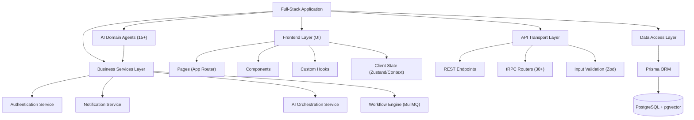

### AI Orchestration

The AI orchestration engine is a core component of AiFWMS. It uses a multi‑agent architecture to handle a wide variety of HR‑related queries. The sequence diagram below shows how a user query flows through the system: from the frontend, through the orchestrator API, to the agent router, and finally to a domain‑specific agent that interacts with large language models (LLMs), retrieval‑augmented generation (RAG), and external tools.

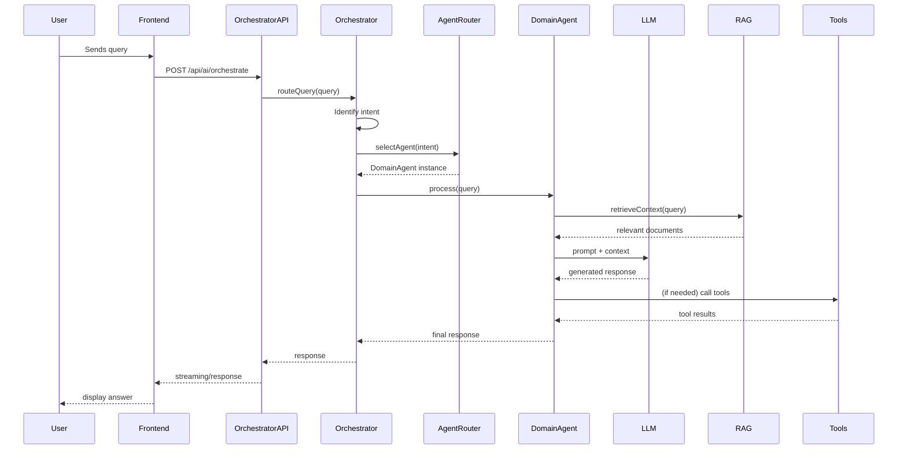

### Background Workers

Time‑consuming or recurring tasks are offloaded to background workers managed by BullMQ and Redis. Six dedicated workers handle leave processing, notifications, payroll, retention analytics, statutory contributions, and workflow execution. The diagram below illustrates how jobs are enqueued, processed, and how results are persisted and notifications are triggered.

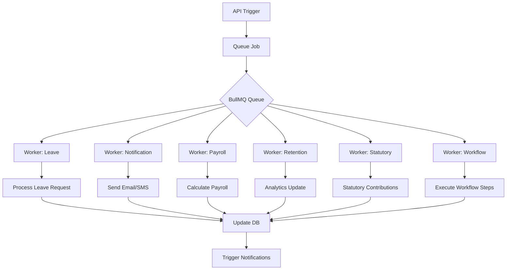

### Deployment Architecture

The application is containerized using Docker and orchestrated with Docker Compose. The deployment stack includes the Next.js app, a PostgreSQL database with pgvector extension, Redis for caching and queue management, and BullMQ workers. The diagram also shows optional integration with Neon serverless PostgreSQL and external AI APIs.

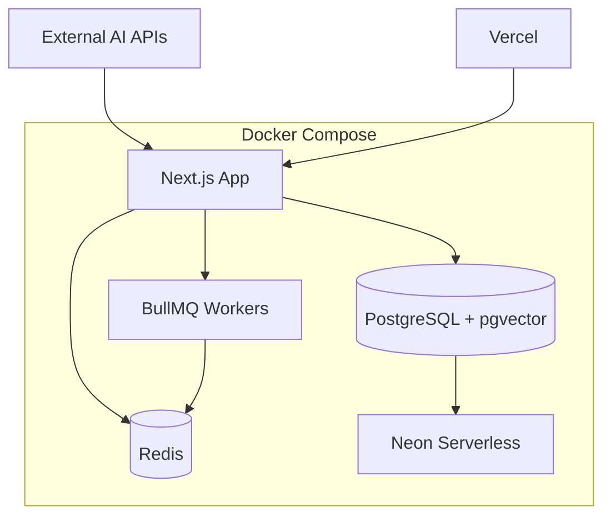

For additional diagrams covering security, i18n, and more detailed component interactions, see [docs/ARCHITECTURE.md](./docs/ARCHITECTURE.md).

---

## Folder Structure

```text
app/                          # Next.js App Router
  [locale]/                   # Locale-first routes (9 languages)
    accounting/               # Accounting product
    ai/                       # AI hub product
    automation/               # Automation product
    capex/                    # CAPEX product
    dashboard/                # HR dashboard product
    employees/                # Employee management
    ess/                      # Employee self-service
    hr/                       # HR operations
    integrations/             # Third-party integrations
    iso/                      # ISO/QMS management
    login/                    # Authentication pages
    mss/                      # Manager self-service
    opex/                     # Operational excellence
  api/                        # API route handlers
    ai/                       # AI endpoints (chat, rag, reason, documents)
    auth/                     # Authentication endpoints
    geolocation/              # Attendance tracking endpoints
    hr-orchestrator/          # Multi-agent AI orchestrator
    iso/                      # ISO/QMS endpoints
    kb/                       # Knowledge base endpoints
    sops/                     # SOP management endpoints
    trpc/                     # tRPC HTTP handler
    webhooks/                 # External webhook receivers
components/                   # React components
  ui/                         # shadcn/ui primitives
  ai-elements/                # AI chat UI components
  charts/                     # Chart components (Recharts)
  dashboard-sidebar/          # Sidebar navigation
  features/                   # Domain-specific feature components
  i18n/                       # Internationalization components
  landing/                    # Landing page components
  layout/                     # Layout components
  platform/                   # Product platform components
config/                       # Application configuration
  navigation.ts               # Product navigation definitions
  products.ts                 # Product registry
  sidebar.ts                  # Sidebar configuration
  server-env.ts               # Server environment validation
docs/                         # Documentation
hooks/                        # Custom React hooks
  useAI.ts                    # AI interaction hooks
  useAuth.ts                  # Authentication hooks
  useTranslation.ts           # i18n hooks
  useDashboard.ts             # Dashboard data hooks
  usePayroll.ts               # Payroll hooks
  # ... 40+ domain-specific hooks
i18n/                         # Internationalization
  config.ts                   # Locale configuration (9 locales)
  locales/                    # Translation files
  I18nProvider.tsx            # i18n provider
lib/                          # Core libraries
  ai/                         # AI agents and tools
  orchestrator/               # HR orchestrator logic
  security/                   # ABAC, RLS, rate-limit, SSRF, XSS
  queues/                     # BullMQ queue configuration
  secrets/                    # Secrets management (env/AWS/Azure)
  prisma.ts                   # Database client
  trpc.ts                     # tRPC client
  # ... domain services
prisma/                       # Database schema and migrations
  schema.prisma               # Prisma schema
  migrations/                 # Database migrations
scripts/                      # Utility scripts
  check-automation-routes.mjs # Route verification
  locale-report.mjs           # Locale coverage report
  validate-locales.mjs        # Locale validation
server/                       # Server-side code
  api/routers/                # tRPC API routers
  routers/                    # Additional tRPC routers
  middleware/                 # ABAC, RLS middleware
  agents/                     # AI domain agents
services/                     # Domain services
  audit-engine.ts             # Audit trail engine
  compliance-scoring-engine.ts# Compliance scoring
  risk-engine.ts              # Risk assessment
  climate-risk-engine.ts      # Climate risk
  corrective-action-engine.ts # CAPA engine
styles/                       # CSS files
  globals.css                 # Tailwind v4 imports
  theme.css                   # Design tokens
types/                        # TypeScript type definitions
utils/                        # Utility functions
workers/                      # BullMQ background workers
  leave.worker.ts             # Leave processing
  notification.worker.ts      # Notification dispatch
  payroll.worker.ts           # Payroll execution
  retention.worker.ts         # Retention analytics
  statutory.worker.ts         # Statutory contributions
  workflow.worker.ts          # Workflow execution
WindowDownloader/             # Electron desktop app
  electron/                   # Electron main process
  src/                        # React renderer
```

---

## Getting Started

### Prerequisites

- Node.js 22+
- PostgreSQL 16+ with pgvector
- Redis 7+
- Docker & Docker Compose (recommended)

### Quick Start

```bash
# Clone and install
git clone <repo-url>
cd fwms
npm install

# Database setup
npx prisma generate
npx prisma db push

# Start development server
npm run dev
```

### Docker Compose

```bash
docker-compose up
```

Starts: PostgreSQL (pgvector), Redis, Next.js app, BullMQ workers.

See [docs/QUICK_START.md](./docs/QUICK_START.md) for detailed setup instructions including individual worker startup, WindowDownloader, and environment configuration.

---

## Environment Variables

| Variable | Description | Required |
|---|---|---|
| `DATABASE_URL` | PostgreSQL connection string | ✅ |
| `NEON_DATABASE_URL` | Neon serverless PostgreSQL (overrides DATABASE_URL) | ⛳ |
| `OPENAI_API_KEY` | OpenAI API key for LLM features | ⛳ |
| `ANTHROPIC_API_KEY` | Anthropic Claude API key | ⛳ |
| `REDIS_URL` | Redis connection string | ⛳ |
| `SECRETS_PROVIDER` | Secrets provider (`env`, `aws`, `azure`) | ⛳ |
| `NEXT_PUBLIC_TENANT_ID` | Tenant identifier | ⛳ |

✅ Required · ⛳ Optional (see [docs/QUICK_START.md](./docs/QUICK_START.md) for full list)

---

## Scripts

| Script | Command | Description |
|---|---|---|
| Dev Server | `npm run dev` | Start Next.js dev server (Turbopack) |
| Production Build | `npm run build` | Build production artifacts (standalone) |
| Production Start | `npm run start` | Run production server |
| Type Check | `npm run typecheck` | Run `tsc --noEmit` |
| Verify Routes | `npm run verify:automation-routes` | Validate automation routes |

---

## Development Workflow

1. Create a feature branch
2. Implement changes with TypeScript + existing domain conventions
3. Ensure tenant scoping and security checks remain intact
4. Run `npm run typecheck` to verify type safety
5. Open a Pull Request
6. See [docs/DEVELOPMENT.md](./docs/DEVELOPMENT.md) for detailed guidance

---

## Code Style

- **Domain services** in `lib/` — keep business logic separate from UI
- **Zod schemas** for validation — defined in `lib/schemas.ts`
- **tRPC** for client-server communication — avoid raw `fetch()`
- **Server-only logic** out of client components — use `'use client'` boundary
- **Tailwind CSS v4** — CSS-first configuration with `@theme` tokens
- **ES2023 target** with `bundler` module resolution

---

## Internationalization

| Feature | Details |
|---|---|
| **Locales** | 11 languages (en, ms, zh, es, id, th, ph, vt, bn, ne, ar) |
| **RTL Support** | Arabic (`ar`) with full bidirectional layout |
| **Translation Namespaces** | common, validation, errors, notifications, email |
| **Formatting** | Locale-specific date, number, and currency formatting |
| **Implementation** | `i18next` + `react-i18next` with file-based translation loading |

---

## Performance

- **Streaming responses** for AI endpoints to reduce perceived latency
- **Tenant-scoped queries** to minimize result sets
- **Standalone output** for optimal production Docker images
- **Turbopack** for fast development builds
- **Redis caching** for queue and session management
- **Memoization** in React components (Framer Motion, useMemo)

---

## Security

| Layer | Implementation |
|---|---|
| **Authentication** | NextAuth.js + MFA (TOTP via otplib) |
| **Authorization** | ABAC (`lib/security/abac.ts`) + RLS middleware (`server/middleware/rls.ts`) |
| **Rate Limiting** | Configurable rate limiter (`lib/security/rate-limit.ts`) |
| **XSS Protection** | Input sanitization with dompurify (`lib/security/xss.ts`) |
| **SSRF Protection** | Outbound request validation (`lib/security/ssrf.ts`) |
| **Secrets Management** | AWS Secrets Manager / Azure Key Vault / Environment variables |
| **Audit Trail** | Event logging and querying (`/dashboard/audit-trail`) |

See [docs/SECURITY.md](./docs/SECURITY.md) for detailed security documentation.

---

## Testing

- **Unit tests**: Co-located with source files (*.test.ts)
- **Integration tests**: Located in `tests/` directory
- **tRPC router tests**: Available for key routers
- **Testing libraries**: Vitest configured for WindowDownloader

---

## Deployment

### Docker (Recommended)

```bash
# Production build
docker build --target production -t aifwms:latest .

# Run with Docker Compose
docker-compose up
```

### Vercel

- Compatible with Vercel deployment for Next.js
- Configure environment variables in Vercel dashboard
- AI runtime compatible with Node.js runtime

### Neon (Serverless PostgreSQL)

```bash
# Set Neon connection string
export NEON_DATABASE_URL="postgresql://..."

# Start stack
docker-compose up
```

---

## Roadmap

The project follows a milestone-based sprint model. See:
- [CHANGELOG.md](./CHANGELOG.md) for detailed progress

### Current Status

- **Sprint 1** — Build Recovery & Technical Stabilization (IN PROGRESS)
- **Sprint 2** — AiFWMS Core Completion
- **Sprint 3** — Compliance & Automation Enhancements
- **Sprint 4** — ISO/QMS Integration

---

## Contributing

1. Fork the repository
2. Create a feature branch
3. Follow existing patterns in `docs/`
4. Submit a PR
5. Ensure typecheck and build pass

### Contribution Principles

- Preserve tenant isolation and RBAC safety
- Never bypass tRPC contracts
- Keep server-only logic in server paths
- Maintain audit/compliance alignment
- Add i18n translations for new UI strings

---

## Changelog

See [CHANGELOG.md](./CHANGELOG.md) for sprint progress, fixes, and versioning.

---

## FAQ

See [docs/FAQ.md](./docs/FAQ.md) for answers to common questions about:
- Multi-tenancy, AI providers, i18n, workers, ISO/QMS, CAPEX/OPEX
- Local development, troubleshooting, and security

---

## License

PROPRIETARY — see [LICENSE](./LICENSE).

---

## Acknowledgements

- **Next.js** & **React** — Web framework and UI library
- **TypeScript** — Type-safe development
- **Tailwind CSS** + **shadcn/ui** + **Radix UI** — Design system
- **Prisma** — Database ORM
- **tRPC** — Type-safe API layer
- **Vercel AI SDK** — AI integration framework
- **BullMQ** — Queue and job processing
- **Redis** — In-memory data store
- **PostgreSQL** + **pgvector** — Database and vector search
- **Framer Motion** — Animation library
- **Recharts** — Charting library
- **React Flow** — Workflow visualization
- **i18next** — Internationalization framework
- **Zustand** — State management
- **Zod** — Schema validation
- **Electron** — Desktop application framework
- **Open Source Community** — All contributors and dependency maintainers
