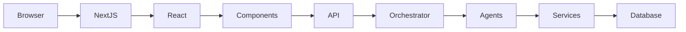
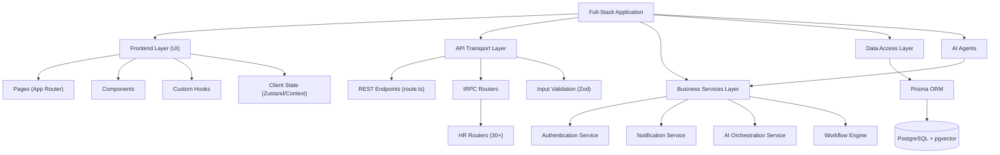
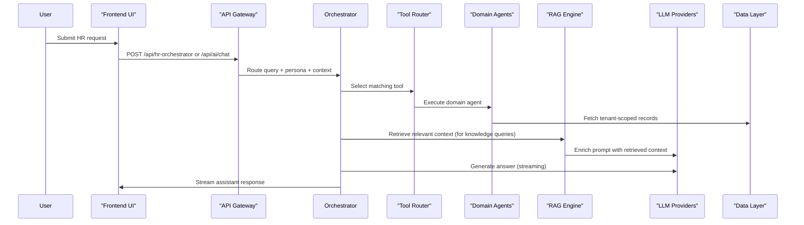
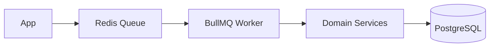
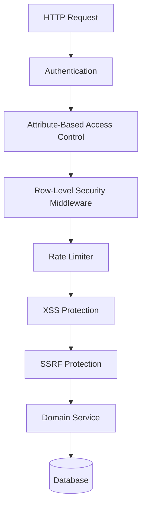
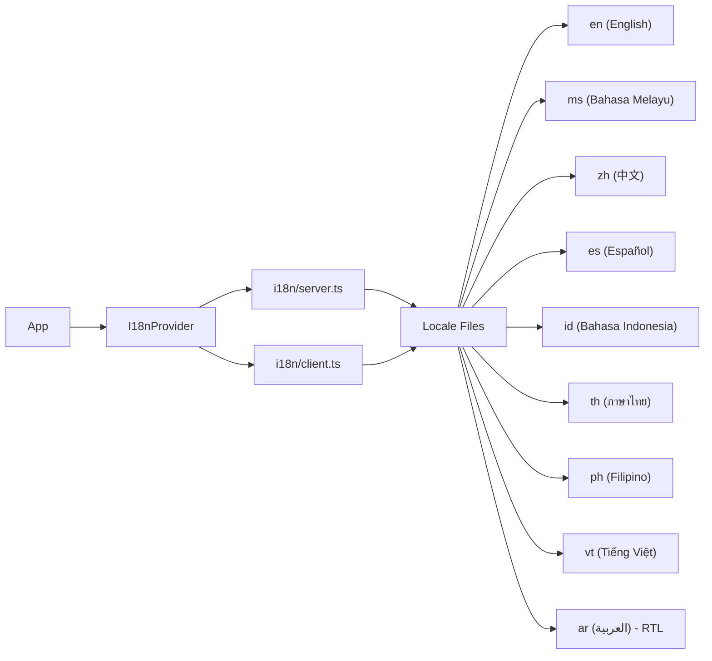

# Architecture

## Overall Architecture

## Application Flow (Middleware → Auth → App Router)

## Product Structure

The application is organized into **9 distinct products**, each with its own sidebar navigation, routes, and domain features:

| Product | Route | Description |
|---|---|---|
| **Dashboard (HR)** | `/dashboard` | HR administration, analytics, workforce management |
| **Accounting** | `/accounting` | Invoices, payroll, tax, e-invoice, government submissions |
| **Automation** | `/automation` | Workflow engine, flow designer, QMS, SOPs, templates |
| **AI Hub** | `/ai` | Chat hub, KB chat, semantic search, HR orchestrator, doc gen |
| **CAPEX** | `/capex` | Assets, projects, budget, ROI, ISO compliance, OPEX |
| **Employees** | `/employees` | Employee management, onboarding, foreign workers, expats |
| **ESS** | `/ess` | Employee self-service — payslips, leave, claims, training |
| **MSS** | `/mss` | Manager self-service — team, approvals, attendance, performance |
| **Integrations** | `/integrations` | Government APIs, third-party connectors, ABAC |

## AI Orchestration Flow (Multi-Agent + Tools + RAG)

### Domain Agents
The orchestrator routes to specialized agents based on the user's query context:

- `fomema` — FOMEMA medical screening
- `payroll` — Payroll explanations and adjustments
- `recruitment` — Resume screening, interview summaries
- `foreign-worker-expatriate` — Visa/permit/immigration queries
- `hr-compliance` — Malaysian labor law compliance
- `hr-quality-management` — Quality management (ISO)
- `learning-development` — Training and development
- `succession-planning` — Career pathing and succession
- `talent-acquisition` — Talent pipeline and sourcing
- `industrial-relations` — Union and dispute management
- `employee-relations` — HR case management
- `immigration` — Immigration policy guidance
- `levy` — Foreign worker levy calculator
- `compensation-benefits` — Compensation analysis
- `employer-branding` — Employer brand guidance
- `hr-analytics` — Workforce analytics and insights
- `leave` — Leave policy and balance queries
- `claude` — Anthropic Claude integration
- `ollama` — Local Ollama integration (fallback)

## BullMQ Worker Architecture

### Workers
| Worker | Purpose |
|---|---|
| `leave.worker` | Process leave requests, approvals, notifications |
| `notification.worker` | Dispatch notifications (email, in-app, push) |
| `payroll.worker` | Execute payroll runs, generate payslips |
| `retention.worker` | Process retention analytics and alerts |
| `statutory.worker` | Calculate and submit statutory contributions (EPF, SOCSO, EIS, PCB) |
| `workflow.worker` | Execute automation workflow steps |

## Security Architecture

### Security Layers
- **Authentication**: NextAuth.js with MFA support (TOTP)
- **ABAC**: Attribute-based access control in `lib/security/abac.ts` + `server/middleware/abac.ts`
- **RLS**: Row-level security middleware in `server/middleware/rls.ts`
- **Rate Limiting**: Configurable rate limiter in `lib/security/rate-limit.ts`
- **XSS Protection**: Input sanitization in `lib/security/xss.ts`
- **SSRF Protection**: Server-side request forgery protection in `lib/security/ssrf.ts`
- **Error Handling**: Structured error handling in `lib/security/error-handler.ts`
- **Secrets Management**: AWS Secrets Manager (`@aws-sdk/client-secrets-manager`) or Azure Key Vault (`@azure/keyvault-secrets`)

## Internationalization (i18n) Architecture

### Supported Locales: 9 languages
- RTL support for Arabic (`ar`)
- BCP-47 locale codes for Intl APIs
- Configurable date/number formatting per locale

## Key Design Principles

- **Tenant-aware scoping** via `NEXT_PUBLIC_TENANT_ID` to prevent cross-tenant leakage
- **tRPC-based API contracts** with Zod input validation (30+ routers)
- **Server-only services** accessed via routers (avoid importing services in `use client` components)
- **AI provider abstraction** — supports OpenAI, Anthropic Claude, and local Ollama
- **pgvector** for semantic search and RAG embeddings
- **BullMQ + Redis** for async job processing and workflow execution
- **Standalone output** for production deployment (Next.js `output: "standalone"`)
- **Tailwind CSS v4** with CSS-first configuration via `@theme` directives
