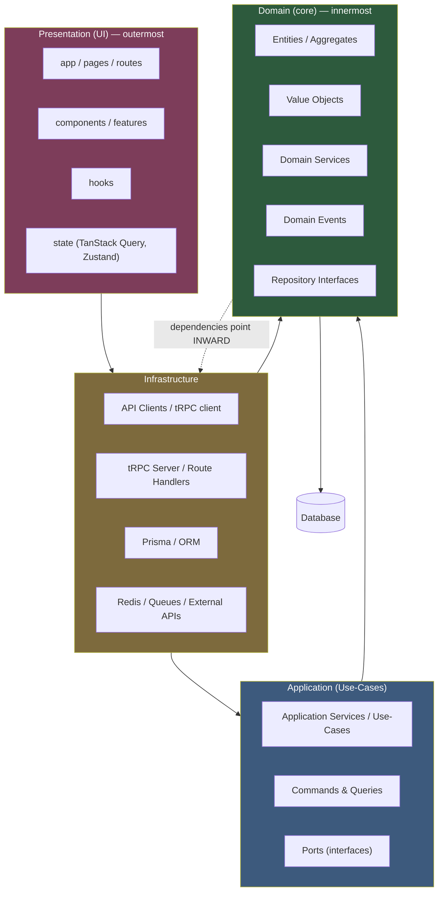
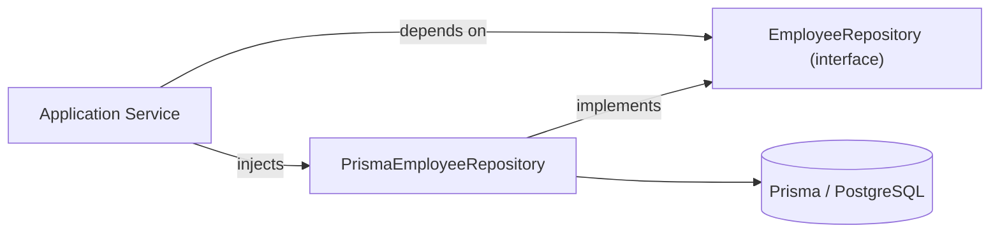
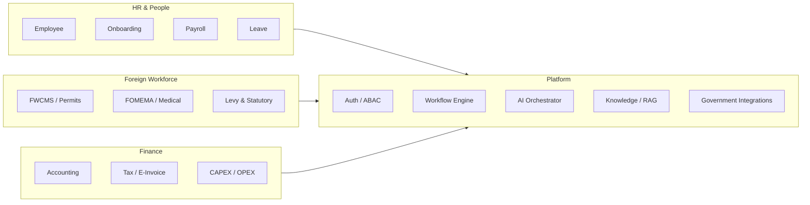

# Production-Ready Clean Architecture + DDD + Feature-Based Organization

> **Reference implementation**: This document describes a production-ready architecture applied to a
> **Next.js 16 + TypeScript + tRPC + Prisma + TanStack Query + Zustand** monolith.
> All patterns mirror the conventions already established in this repository
> (`lib/shared-kernel`, `server/routers`, `hooks`, `components/features`, `app/[locale]`, `services`).

---

## Table of Contents

1. [High-Level Overview](#1-high-level-overview)
2. [Production-Ready Folder Tree](#2-production-ready-folder-tree)
3. [Folder-by-Folder Guide](#3-folder-by-folder-guide)
4. [Request Flow](#4-request-flow)
5. [Authentication Flow](#5-authentication-flow)
6. [API Flow](#6-api-flow)
7. [Routing Flow](#7-routing-flow)
8. [State Management Flow](#8-state-management-flow)
9. [Error Handling](#9-error-handling)
10. [Folder Dependency Graph](#10-folder-dependency-graph)
11. [Best Practices](#11-best-practices)
12. [Naming Conventions](#12-naming-conventions)
13. [Example Implementations](#13-example-implementations)

---

## 1. High-Level Overview

We combine **three complementary organizational strategies**:

| Strategy | Solves | Unit of organization |
|---|---|---|
| **Clean Architecture** | Separation of concerns, dependency inversion, testability | **Layers** (`domain`, `application`, `infrastructure`, `presentation`) |
| **Domain-Driven Design (DDD)** | Business complexity, ubiquitous language, bounded contexts | **Bounded Contexts & Tactical Patterns** (Aggregate, Value Object, Repository, Domain Event, Application Service) |
| **Feature-Based Organization** | Scalability, discoverability, colocation | **Feature Slices** (`components/features/payroll`, `hooks/usePayroll.ts`, `server/routers/payroll.ts`) |

### Clean Architecture Onion



**The Dependency Rule** (the core of Clean Architecture):

> Source code dependencies always point **inward** toward the Domain layer.
> The Domain layer depends on **nothing** — no framework, no database, no HTTP.
> Outer layers depend on abstractions (ports) defined in inner layers,
> never on concrete implementations of outer layers.

### Dependency Inversion in practice



### Bounded Contexts (this monolith)



Each bounded context owns its **ubiquitous language** (e.g., *Levy*, *FOMEMA*, *Payslip*, *Visa Renewal*) and maps to a feature slice in `components/features/`, a set of hooks, a tRPC router, and — where needed — a domain service under `services/`.

---

## 2. Production-Ready Folder Tree

A **hybrid structure** — feature-first for the presentation/application layers,
bounded-context-first for the domain layer. This mirrors the actual repository layout.

```text
├── app/                                # Next.js App Router — composition root (Presentation)
│   ├── [locale]/                       #   localized route segment (en, ms, zh, ar, …)
│   │   ├── (auth)/login/               #   auth route group
│   │   ├── dashboard/                  #   feature routes (products)
│   │   ├── employees/
│   │   ├── accounting/
│   │   ├── ai/
│   │   ├── automation/
│   │   ├── ess/
│   │   ├── mss/
│   │   └── layout.tsx                  #   locale-aware root layout
│   ├── api/                            # Route Handlers / HTTP contracts
│   │   ├── auth/[...nextauth]/route.ts
│   │   ├── trpc/[trpc]/route.ts        #   tRPC HTTP transport
│   │   ├── health/route.ts
│   │   └── webhooks/route.ts
│   ├── error.tsx                       # root error boundary
│   ├── global-error.tsx
│   ├── not-found.tsx
│   └── providers/                      # app-wide providers (tRPC, Theme, i18n)
│
├── components/                         # UI composition layer (Presentation)
│   ├── ui/                             #   design-system primitives (button, input, dialog)
│   ├── shared/                         #   cross-feature generic components
│   ├── platform/                       #   product shell (sidebar, header, switcher)
│   ├── layout/                         #   page shells, navbars, providers
│   ├── features/                       #   feature-scoped components (colocated per bounded context)
│   │   ├── employee/
│   │   ├── payroll/
│   │   ├── compliance/
│   │   └── …
│   ├── ai-elements/                    #   AI-specific presentational components
│   ├── charts/                         #   data-viz wrappers
│   └── system/                         #   error states, fallbacks, feedback
│
├── hooks/                              # Custom hooks — data access + UI logic (Presentation)
│   ├── useEmployee.ts
│   ├── usePayroll.ts
│   ├── useAuth.ts
│   ├── use-toast.ts
│   ├── use-debounce.ts
│   ├── useSearchParams.ts
│   └── client/                         #   client-only hooks (tRPC, capabilities)
│
├── lib/                                # Infrastructure + shared helpers
│   ├── prisma.ts                       #   Prisma client singleton
│   ├── trpc.ts                         #   client-side tRPC (createTRPCReact)
│   ├── trpc-server.ts                  #   server caller factory
│   ├── session.ts                      #   session types/verification
│   ├── logger.ts                       #   structured logging (pino)
│   ├── env.ts                          #   validated environment config
│   ├── schemas.ts                      #   Zod schemas (canonical contracts)
│   ├── services.ts                     #   engine/service registry (composition root)
│   ├── constants/                      #   domain constants (levy rates, ports)
│   ├── shared-kernel/                  #   cross-cutting domain primitives
│   │   ├── types/                      #     Result, Money, TenantId, Pagination
│   │   ├── events/                     #     DomainEvent, EventBus
│   │   └── security/                   #     permission types
│   ├── security/                       #   ABAC, RLS helpers, rate-limit, XSS/SSRF
│   ├── ai/                             #   AI agents (domain-specialized)
│   ├── ahros/                          #   AI orchestration core
│   ├── rag/                            #   RAG / embeddings / knowledge base
│   ├── queues/                         #   BullMQ connection & queue defs
│   ├── zustand/                        #   UI-state stores
│   ├── server/                         #   server-only auth helpers
│   ├── integrations/                   #   third-party / government connectors
│   ├── actions/                        #   server actions (colocated)
│   └── sop/                            #   SOP pipeline
│
├── server/                             # tRPC server layer (Application/Infrastructure)
│   ├── trpc.ts                         #   context, router, procedure factories
│   ├── root.ts                         #   appRouter composition root
│   ├── routers/                        #   feature routers (one per bounded context)
│   │   ├── payroll.ts
│   │   ├── employee.ts
│   │   ├── leave.ts
│   │   └── …
│   ├── api/                            #   secondary tRPC API + router groups
│   ├── middleware/                     #   ABAC, RLS middleware
│   ├── agents/                         #   agent definitions & prompts (server-only)
│   └── context.ts                      #   per-request context builder
│
├── services/                           # Domain services / engines (Domain layer)
│   ├── audit-engine.ts
│   ├── risk-engine.ts
│   ├── compliance-scoring-engine.ts
│   ├── payroll-service.ts
│   └── accommodation/                  #   subdomain services
│
├── types/                              # Shared TypeScript types (derived from Zod)
│   ├── index.ts
│   ├── service.ts
│   └── worker.ts
│
├── utils/                              # Pure, framework-agnostic utilities
│   ├── currency.ts
│   ├── index.ts
│   ├── malaysian-tax/
│   ├── pdf/
│   └── geolocation/
│
├── config/                             # Static configuration & navigation
│   ├── navigation.ts
│   ├── products.ts
│   ├── sidebar.ts
│   └── server-env.ts
│
├── i18n/                               # Internationalization (Presentation)
│   ├── config.ts                       #   locale list, dir, labels
│   ├── server.ts / client.ts
│   ├── I18nProvider.tsx
│   └── locales/                        #   JSON translation files
│
├── prisma/                             # Database schema & migrations
│   ├── schema.prisma
│   └── migrations/
│
├── workers/                            # BullMQ workers (async jobs)
### `utils/` — Pure Utilities

- **Purpose**: Framework-agnostic helper functions with no business rules.
- **Responsibilities**: Currency formatting, compliance helpers, tax calculators, PDF generators (see `utils/currency.ts`, `utils/geolocation/`, `utils/malaysian-tax/`, `utils/pdf/`).
- **What belongs there**: Pure, side-effect-free functions; testable units.
- **What should NEVER be placed there**: Components, hooks, routers, state.
- **Dependency direction**: `utils/` ← anything; it depends on nothing but stdlib/types.

### `workers/` — Async Job Processors

- **Purpose**: BullMQ workers that consume Redis queues for background/async work.
- **Responsibilities**: Leave processing, notifications, payroll runs, statutory submissions, workflow execution.
- **What belongs there**: Worker entry points, job handlers.
- **What should NEVER be placed there**: Request/response handlers, UI code.
- **Dependency direction**: `workers/` → `lib/` (queues, services). It is started independently.

---

## 4. Request Flow

```mermaid
sequenceDiagram
  participant B as Browser
  participant R as Router (middleware.ts)
  participant P as Page (app/[locale]/…)
  participant H as Hook (hooks/)
  participant S as Service (lib/ or services/)
  participant A as API Client (lib/trpc.ts)
  participant Srv as tRPC Server (server/routers/)
  participant D as Domain (shared-kernel/entities)
  participant DB as Database (Prisma/PostgreSQL)

  B->>R: GET /dashboard (with locale)
  R->>R: rate limit → security headers → CSRF → auth → locale detect
  R->>P: render page (Server Component)
  P->>H: "use client" → useDashboard()
  H->>A: trpc.dashboard.getData.query()
  A->>Srv: POST /api/trpc (HTTP)
  Srv->>Srv: context (session) → RLS/ABAC → zod input validation
  Srv->>S: call use-case → domain service
  S->>D: enforce invariants, build aggregate
  S->>DB: repository persists via Prisma
