# 🏗️ MASTER TRANSFORMATION BLUEPRINT: AI-Native Enterprise OS (AHROS)

Based on deep audit of the codebase (300+ pages, 60+ UI components, AHROS core, `.claude/` ecosystem, 16 AI agents, multi-product architecture), here is the full implementation plan structured across seven interdependent phases. Each phase builds the foundation for the next, culminating in a fully operational AI-Native Enterprise OS.

**The Strategic Roadmap:**
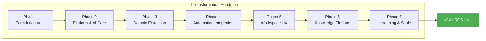

---

## Phase 1 — Foundation Audit & Domain Mapping
**Goal:** Understand current state, map all domains, identify overlaps, establish the baseline.

| Deliverable | Description | Key Output |
| :--- | :--- | :--- |
| 1. Enterprise Information Architecture | Map all 300+ pages into the 6-layer model (Platform, Executive Dashboard, Business Domains, AI Platform, Shared Platform, Design System) | `/docs/architecture/INFORMATION_ARCHITECTURE.md` |
| 2. Product Capability Map | Comprehensive capability-to-page mapping showing what exists, what overlaps, and what's missing | `/docs/architecture/CAPABILITY_MAP.md` |
| 3. Domain Ownership Matrix | Every component, hook, page, API, store, and lib file assigned to exactly one domain | `/docs/architecture/DOMAIN_OWNERSHIP.md` |
| 4. Design System Inventory | Audit existing 60+ UI primitives, identify gaps vs enterprise needs, codify foundations | `/docs/design-system/INVENTORY.md` |
| 5. Shared Component Inventory | Identify components used across products that should be promoted to shared platform | `/docs/architecture/SHARED_COMPONENTS.md` |
| 6. Technical Debt Reduction Plan | Items from the existing `ANALYSIS_CLAUDE.md` audit — auth, tenant isolation, dual orchestrator, testing, etc. | `/docs/tech-debt/REDUCTION_PLAN.md` |

**The Audit-to-Architecture Pipeline:**
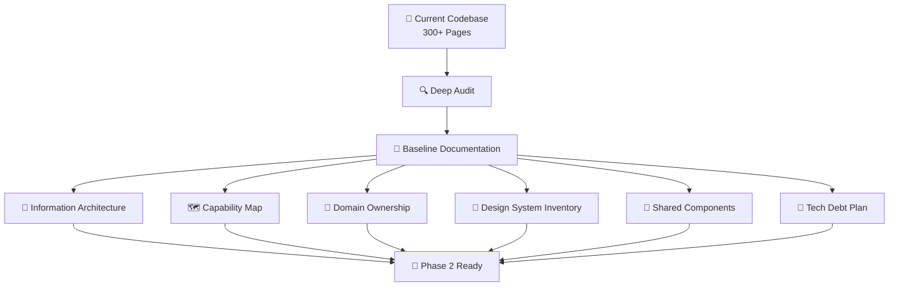

**Files to create/update:**
- `/docs/architecture/INFORMATION_ARCHITECTURE.md` (new)
- `/docs/architecture/CAPABILITY_MAP.md` (new)
- `/docs/architecture/DOMAIN_OWNERSHIP.md` (new)
- `/docs/design-system/INVENTORY.md` (new)
- `/docs/architecture/SHARED_COMPONENTS.md` (new)
- `/docs/tech-debt/REDUCTION_PLAN.md` (new)

---

## Phase 2 — Platform, Design System & AI Foundation
**Goal:** Build the underlying infrastructure layers that everything else depends on.

### 2A — Platform Layer (Infrastructure)

| Task | Files | Description |
| :--- | :--- | :--- |
| App Shell | `components/platform/AppShell.tsx` | Central shell with left nav, center workspace, right AI context, bottom timeline |
| Command Palette | `components/platform/CommandPalette.tsx` | Global `Cmd+K` to search anything, navigate anywhere |
| Plugin Registry | `lib/platform/plugin-registry.ts` | Plugin interface + registry for extensibility |
| Feature Flags | `lib/platform/feature-flags.ts` | Flag-based feature toggling |
| Audit Infrastructure | `lib/platform/audit-logger.ts` | Immutable audit trail across all domains |

**Platform Foundation Flow:**
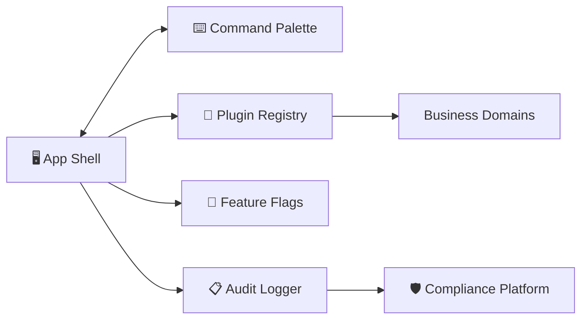

### 2B — Design System Foundations

| Task | Files | Description |
| :--- | :--- | :--- |
| Design Tokens | `styles/design-tokens.ts` | Typography (scale, weights), spacing (4px grid), colors (semantic tokens), elevation, motion |
| Enterprise Components | Add to `components/ui/` | `DataGrid`, `Timeline`, `WorkflowCanvas`, `ArtifactViewer`, `KnowledgeTree`, `ReasoningPanel`, `ExecutionMonitor`, `ApprovalCards`, `StatusIndicators`, `AIPanels` |
| Theme System | Enhance `components/theme-provider.tsx` | Support brand themes per tenant |

### 2C — AI Platform Infrastructure

| Task | Files | Description |
| :--- | :--- | :--- |
| AI Agent Runtime | `ai/runtime/` | Agent lifecycle management, tool registry, model routing |
| AI Memory System | `ai/memory/` | Persistent memory across conversations (builds on existing `memory-store.ts`) |
| AI Prompt Library | `ai/prompt-library/` | Versioned, reusable prompt templates per domain |
| AI Tools | `ai/tools/` | Tool definitions per domain (expand from existing 5 tools to 20+) |
| AI Models | `ai/models/` | Model config registry (OpenAI, Anthropic, Ollama) |
| AI Planning | `ai/planning/` | Plan generation, validation, human review gates |
| AI Reasoning | `ai/reasoning/` | Chain-of-thought, step-by-step reasoning display |
| AI Checkpoints | `ai/checkpoints/` | Execution checkpoint/restore for workflows |

**AI Inner Architecture & Data Flow:**
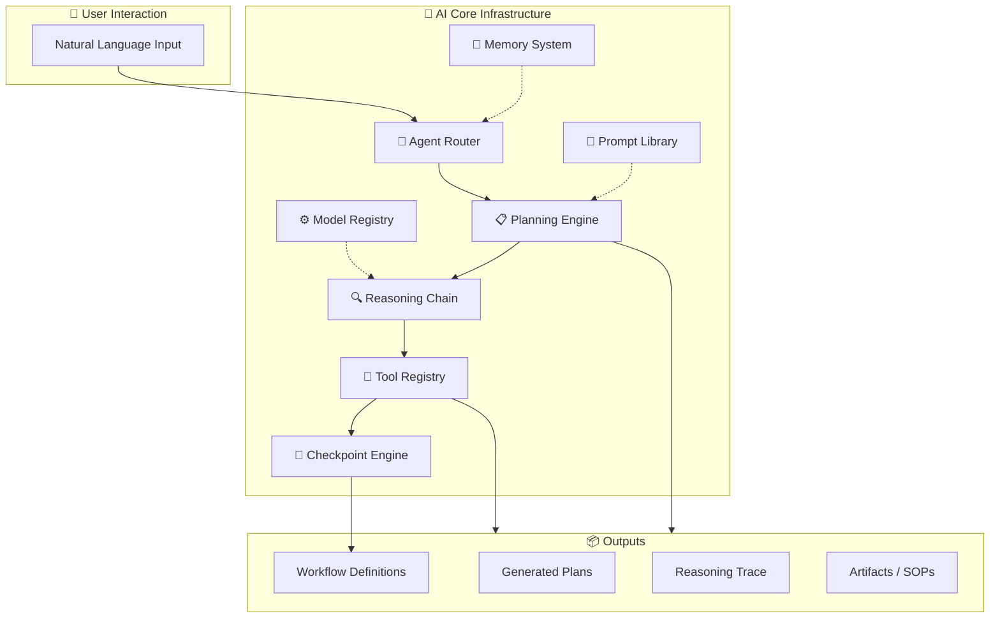

**Files to create:**
- `ai/runtime/` + `ai/memory/` + `ai/prompt-library/` + `ai/tools/` + `ai/models/` + `ai/planning/` + `ai/reasoning/` + `ai/checkpoints/`
- `components/platform/AppShell.tsx`, `CommandPalette.tsx`
- `lib/platform/plugin-registry.ts`, `feature-flags.ts`, `audit-logger.ts`
- `styles/design-tokens.ts`
- New `components/ui/` enterprise components (10+)

---

## Phase 3 — Extract Bounded Business Domains
**Goal:** Every real-world capability owns its own bounded context with clear boundaries.

For each business domain, create:
```
domains/{domain}/
├── pages/          (route components)
├── components/     (domain-specific UI)
├── hooks/          (domain-specific hooks)
├── stores/         (Zustand stores if needed)
├── api/            (tRPC routers)
├── schemas/        (Zod schemas)
├── permissions/    (domain-specific permissions)
├── docs/           (domain documentation)
├── templates/      (templates)
├── workflows/      (workflow definitions)
└── tests/          (domain tests)
```

**Initial Domains by Priority:**
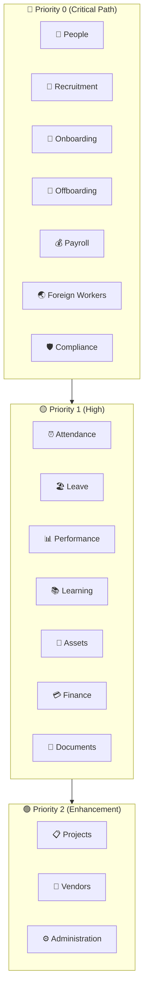

**Detailed Domain Extraction Matrix:**

| Domain | Current Location | New Location | Priority |
| :--- | :--- | :--- | :--- |
| People | `hooks/useEmployee.ts`, `components/features/employee/`, `/app/[locale]/employees/` | `domains/people/` | **P0** |
| Recruitment | `hooks/useRecruitment.ts`, `components/features/talent-acquisition/` | `domains/recruitment/` | **P0** |
| Onboarding | Spread across employees + dashboard | `domains/onboarding/` | **P0** |
| Offboarding | Spread across employees + dashboard | `domains/offboarding/` | **P0** |
| Payroll | `hooks/usePayroll.ts`, `components/features/accounting/` | `domains/payroll/` | **P0** |
| Foreign Workers | `hooks/useForeignWorker.ts`, `hooks/useExpat.ts` | `domains/foreign-workers/` | **P0** |
| Compliance | `hooks/useCompliance.ts`, `lib/compliance-engine.ts` | `domains/compliance/` | **P0** |
| Attendance | `hooks/useScheduling.ts`, `components/features/scheduling/` | `domains/attendance/` | **P1** |
| Leave | `hooks/useLeave.ts` | `domains/leave/` | **P1** |
| Performance | `hooks/useSuccession.ts`, `components/features/performance/` | `domains/performance/` | **P1** |
| Learning | `hooks/useAdmin.ts` (partial) | `domains/learning/` | **P1** |
| Assets | CAPEX module | `domains/assets/` | **P1** |
| Finance | Accounting module | `domains/finance/` | **P1** |
| Documents | `hooks/useDocument.ts` | `domains/documents/` | **P1** |
| Projects | CAPEX projects | `domains/projects/` | **P2** |
| Vendors | Not yet extracted | `domains/vendors/` | **P2** |
| Administration | Settings, admin pages | `domains/administration/` | **P2** |

**Dependency mapping:** Create `/docs/architecture/DEPENDENCY_GRAPH.md` showing domain interdependencies.

**Domain Decoupling Contract:**
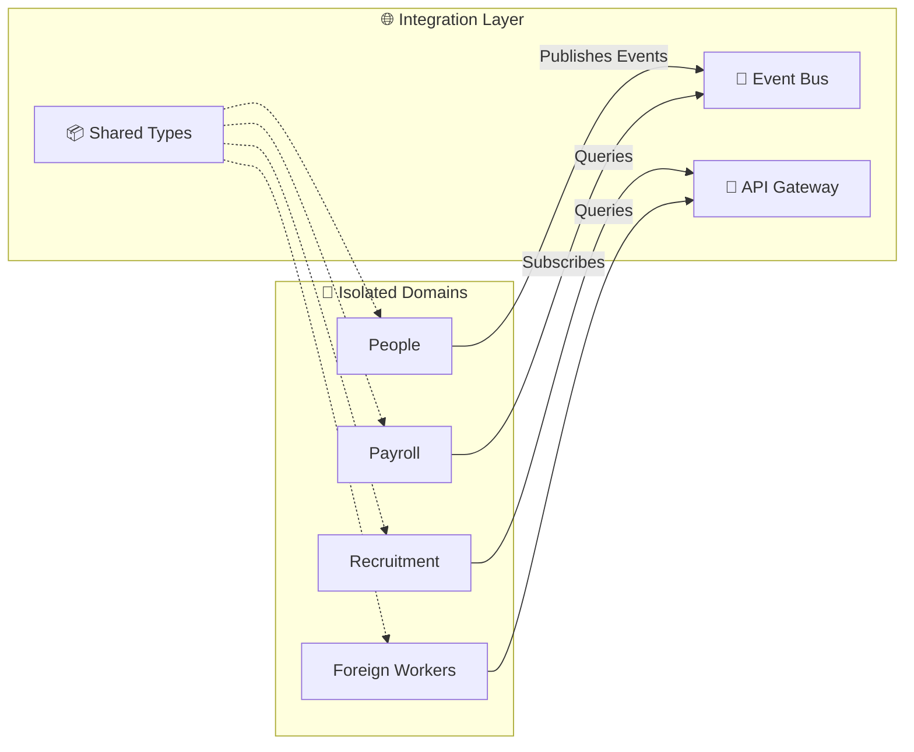

---

## Phase 4 — Automation Platform + AI Integration
**Goal:** Move workflows into a unified Automation Platform, deeply integrate AI into every domain.

### 4A — Automation Platform Components

| Component | Description |
| :--- | :--- |
| **Flow Studio** | WYSIWYG workflow designer (extends existing `automation/designer`) |
| **Planner** | AI-powered workflow planner that converts intent → plan → workflow |
| **Executions** | Workflow execution engine with real-time monitoring |
| **Templates** | Pre-built workflow templates per domain |
| **Triggers** | Event-driven triggers (schedules, webhooks, business events) |
| **Retry Engine** | Exponential backoff, dead-letter queues |
| **Agent Runtime** | AHROS execution engine integration |
| **Checkpoint Engine** | Save/resume workflow execution at any step |
| **Integrations** | Government API connectors, third-party integrations |
| **Workflow Marketplace** | Shareable workflow templates |

**Automation Lifecycle:**
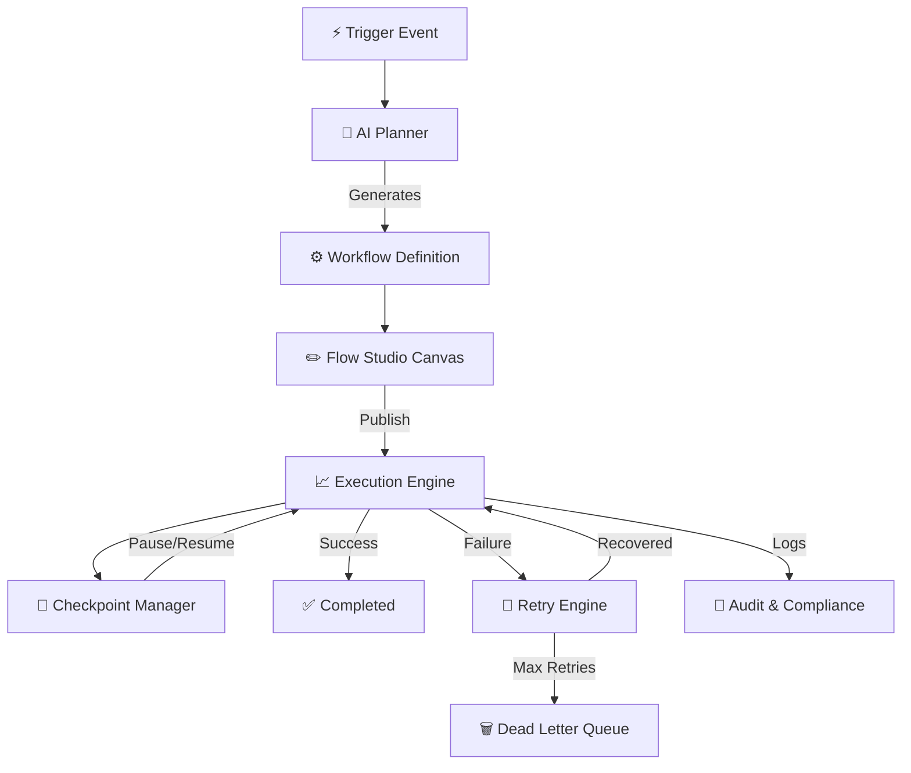

### 4B — AI Integration into Domains

Every domain gets AI-powered services:

| Domain | AI Service |
| :--- | :--- |
| People | AI employee profile analysis, skills gap detection |
| Recruitment | AI resume screening, interview question generation |
| Onboarding | AI onboarding checklist generation, document verification |
| Payroll | AI anomaly detection, payroll explanation |
| Leave | AI leave pattern analysis, predictive absence |
| Compliance | AI compliance checking, risk scoring |
| Foreign Workers | AI permit application assistant |
| Performance | AI performance review assistant, 360 feedback analysis |
| Learning | AI learning path recommendation |

---

# PHASE 4.5 — Architecture Simplification & Zustand Consolidation

Evaluate the application's architecture for unnecessary complexity, duplicated state management, and fragmented routing.

Only recommend or implement changes when they provide a clear improvement backed by evidence.

## Routing Architecture

Review:

- Route organization
- Nested routing complexity
- Route duplication
- Dynamic route consistency
- Protected routes
- Layout hierarchy
- Navigation flow
- Route guards
- Lazy loading
- Code splitting
- Feature-based routing

If the routing structure is overly complex or difficult to maintain:

- Propose a simplified routing architecture.
- Consolidate duplicated route definitions.
- Group routes by feature/domain.
- Eliminate unnecessary nesting.
- Centralize route configuration where appropriate.

---

## Zustand State Management

Analyze the entire application state.

Identify:

- Duplicate React state
- Prop drilling
- Context providers with global state
- Redundant Context API usage
- Duplicate business state
- Duplicate API cache state
- Local state that should be shared
- State synchronization issues
- Unnecessary re-renders
- Multiple sources of truth

If appropriate, recommend migrating to Zustand.

Only migrate state when ALL of the following are true:

- Reduces complexity
- Removes prop drilling
- Improves maintainability
- Preserves type safety
- Does not introduce unnecessary global state

Do NOT migrate simple component-local state.

---

## Zustand Store Design

When recommending Zustand:

Design stores using feature/domain separation.

Example:

```
stores/
    auth.store.ts
    payroll.store.ts
    employee.store.ts
    claims.store.ts
    statutory.store.ts
    ui.store.ts
    settings.store.ts
    notifications.store.ts
```

Avoid creating a single monolithic store.

Each store should:

- Have a single responsibility
- Be fully typed
- Expose selectors
- Expose actions
- Avoid duplicated state
- Avoid derived state duplication
- Use middleware only when justified
- Support persistence only where necessary

---

## State Consolidation

Merge duplicate state across:

- React Context
- Redux
- MobX
- Jotai
- Recoil
- Multiple custom hooks
- Duplicate API stores
- Component state

Where safe, consolidate into Zustand.

---

## API Integration

Review how data fetching interacts with state.

Identify:

- Duplicate fetches
- Duplicate cache
- Multiple API calls for identical data
- Missing optimistic updates
- Incorrect invalidation
- Unnecessary refetches

Recommend whether state should remain in:

- TanStack Query
- Tanstack Intent  

or be moved into Zustand.

Do NOT duplicate server state inside Zustand unless there is a valid architectural reason.

---

## UI State

Recommend moving appropriate UI state into Zustand, including:

- Sidebar
- Theme
- Modal manager
- Toasts
- Dialogs
- Global loading
- Navigation
- Filters
- Dashboard preferences
- Wizard state

Avoid storing ephemeral component-only state globally.

---

## Deliverables

Provide:

- Current architecture assessment
- Recommended architecture
- Zustand migration opportunities
- Stores to create
- Stores to merge
- Context providers that can be removed
- Hooks that become unnecessary
- Estimated reduction in complexity
- Estimated reduction in re-renders
- Migration risk
- Step-by-step migration plan

For every recommendation include:

- Evidence
- Confidence (High / Medium / Low)
- Expected benefit
- Breaking change risk

---

## Phase 5 — Workspace UX + Artifact Synchronization
**Goal:** Replace page-centric UX with the Workspace UX. Every interaction becomes a workspace session.

### 5A — Workspace Architecture
```
app/workspace/
├── [workspaceId]/
│   ├── page.tsx                    (main workspace)
│   ├── conversation/               (left panel)
│   ├── planning/                   (left panel)
│   ├── workflow/                   (center canvas)
│   ├── reasoning/                  (right panel)
│   ├── timeline/                   (bottom panel)
│   ├── compliance/                 (right panel)
│   ├── knowledge/                  (floating dock)
│   └── artifacts/                  (artifact viewer)
```

**The Workspace Shell becomes the default UI:**
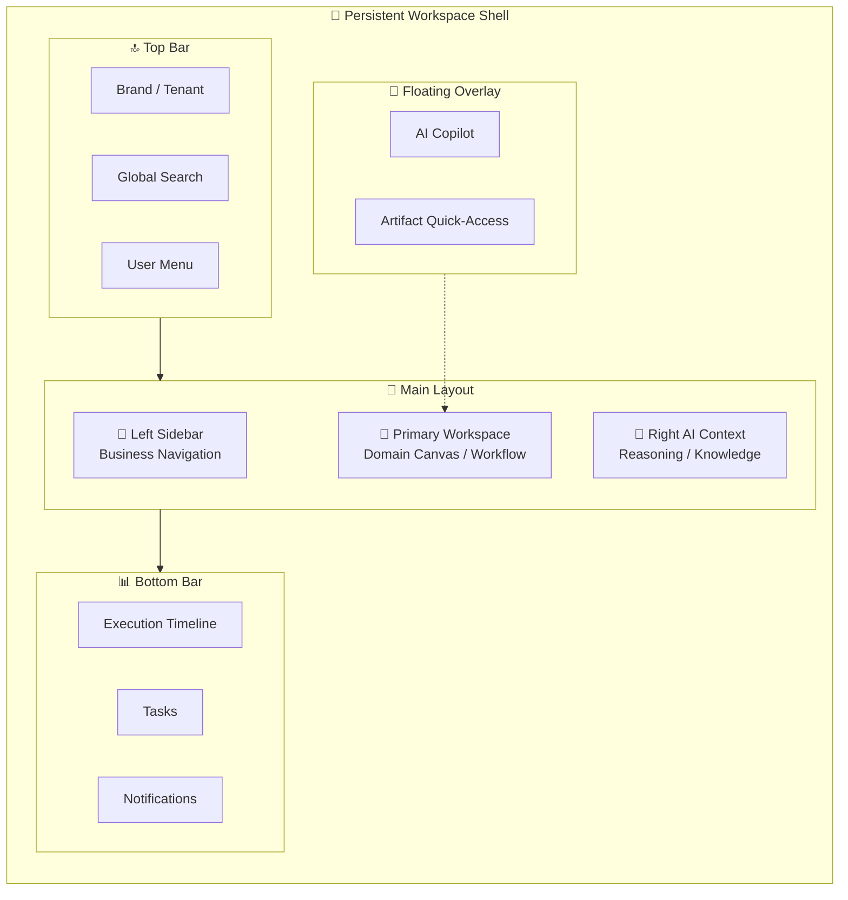

### 5B — Navigation Restructure

**Current (Product-Centric):**
```
Dashboard | Accounting | Automation | AI | CAPEX | Employees
```

**New (Business-Language):**
```
Dashboard | Workspace | People | Recruitment | Payroll | Attendance |
Leave | Foreign Workers | Compliance | Automation | Knowledge |
Documents | Analytics | Administration | AI Copilot
```

**Route Hierarchy:**
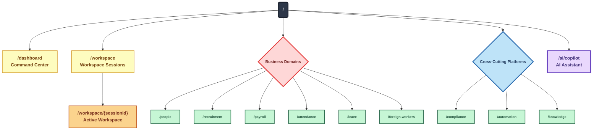

# 🎨 Color Hierarchy Legend:
- Level	Node Type	Color	Purpose
- Level 1	Root /	Dark gray	Entry point
- Level 2	Business Domains	Red/Pink	Domain category
- Level 2	Cross-Cutting Platforms	Blue	Platform category
- Level 3	Path nodes (/people, etc.)	Green	Individual endpoints
- Level 3	Workspace	Yellow	Session container
- Level 4	Session {sessionId}	Orange	Dynamic session
- Special	Copilot AI	Purple	AI assistant feature

# 📊 Visual Hierarchy Features:
1. Color coding - Each level has distinct colors for quick recognition

2. Stroke width - Higher-level nodes have thicker borders (3px vs 2px)

3. Font weight - Categories and root are bold, endpoints are normal

4. Font size - Root (16px) > Categories (14px) > Endpoints (12px)

5. Shape distinction - Diamonds for categories, rectangles for endpoints


### 5C — Artifact Synchronization Model
Every workspace automatically synchronizes artifacts through the event bus. The following chain ensures **no duplication**:

```mermaid
flowchart LR
    User[👤 User Input] -->|Triggers| AI[🧠 AI Processing]
    AI --> Plan[📝 Plan Generated]
    Plan --> WF[⚙️ Workflow Created]
    WF --> Exec[📈 Execution Runs]
    Exec --> Comp[🛡️ Compliance Checked]
    Comp --> Know[📚 Knowledge Extracted]
    Know --> SOP[📖 SOP Generated]
    SOP --> Timeline[⏳ Timeline Updated]
    
    subgraph Sync[🔄 All Artifacts Synchronized]
        direction LR
        A[Conversation] <--> B[Plan]
        B <--> C[Workflow]
        C <--> D[Reasoning]
        D <--> E[Execution]
        E <--> F[Timeline]
        F <--> G[Audit]
        G <--> H[Compliance]
        H <--> I[Knowledge]
        I <--> J[SOP]
        J <--> K[Checkpoints]
        K <--> L[Learning]
    end
```

**Update files:**
- `lib/ahros/event-bus.ts` — enhance for cross-session sync
- `lib/ahros/artifact-registry.ts` — add cross-domain sync
- `components/ahros/workspace/ahros-workspace.tsx` — make the default
- `config/navigation.ts` — restructure for business language

---

## Phase 6 — Knowledge Platform & Living Documentation
**Goal:** Every execution automatically creates knowledge. The platform learns and documents itself.

| Component | Description |
| :--- | :--- |
| **SOP Generator** | Auto-generate SOPs from every workflow execution (exists partially in `lib/sop/`) |
| **Playbook Generator** | Generate playbooks from repeated execution patterns |
| **Timeline Generator** | Visual execution timeline with step-by-step details |
| **Audit Report Generator** | Auto-generated compliance audit reports |
| **Architecture Diagram Generator** | Visual workflow architecture diagrams |
| **Compliance Report Generator** | Enhanced from `lib/ahros/compliance-reporter.ts` |
| **Meeting Notes Generator** | AI-generated meeting notes from workspace sessions |
| **Workflow Documentation** | Auto-document workflows as they're created |
| **Decision History** | Log every AI decision with reasoning |
| **Learning Summary** | Weekly/monthly learning digests |

**Knowledge Generation Pipeline:**
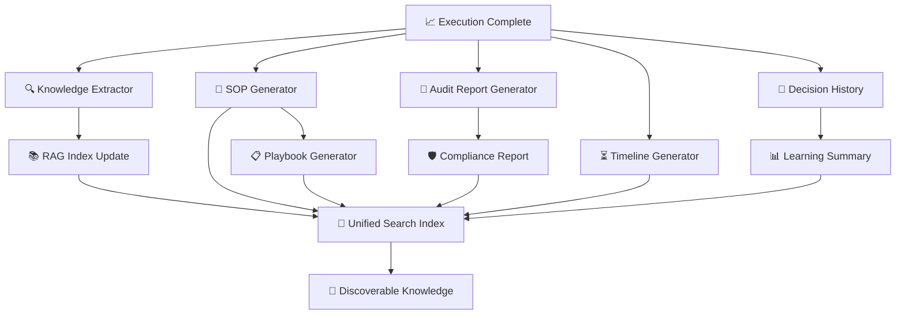

**Knowledge is:**
- **Searchable** — via semantic search (already partially in `lib/rag.ts`, `hooks/useSemanticSearch.ts`)
- **Versioned** — via artifact registry versioning
- **Continuously evolving** — via learning engine (`lib/ahros/learning-engine.ts`)

---

## Phase 7 — Performance, Testing, Accessibility, Observability

### 7A — Performance Plan

| Strategy | Implementation |
| :--- | :--- |
| Lazy-load domains | Dynamic imports for all domain pages |
| Stream AI responses | Vercel AI SDK streaming (already partially) |
| Virtualize datasets | Add `react-window` for large employee tables |
| Incremental rendering | Server components where possible, streaming for AI |
| Optimistic updates | Via `lib/ahros/optimistic-bus.ts` |
| Prefetch routes | Next.js prefetch for likely navigation |
| Cache workflows | SWR/stale-while-revalidate for workflow state |
| Memoization | React.memo, useMemo, useCallback audit |

**Performance Optimization Flow:**
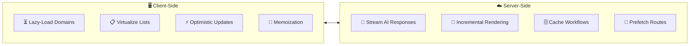

### 7B — Testing Strategy

| Layer | Tool | Coverage Target |
| :--- | :--- | :--- |
| Unit (domain logic) | Vitest | 90%+ |
| Integration (API routes) | Vitest + tRPC testing | 80%+ |
| Component (UI) | Storybook + Vitest | 70%+ |
| E2E (critical flows) | Playwright | Critical paths |
| AI/Skill evals | `/skill-eval` commands | 100% of skills |

### 7C — Accessibility
- ARIA labels throughout
- Keyboard navigation for all workspace interactions
- Screen reader support for AI content (streaming text)
- Color contrast compliance (WCAG 2.1 AA)
- Focus management in workspace panels
- Reduced motion support (already partially via `useReducedMotion`)

### 7D — Observability

**Observability Architecture:**
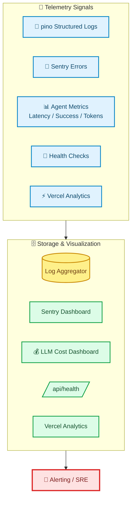

- `pino` structured logging (already installed, wire up)
- Sentry error tracking
- Agent execution metrics (latency, success rate, token usage)
- LLM cost dashboard
- Health check endpoint at `/api/health`
- Performance monitoring (Vercel Analytics)

---

## Summary of Files to Create

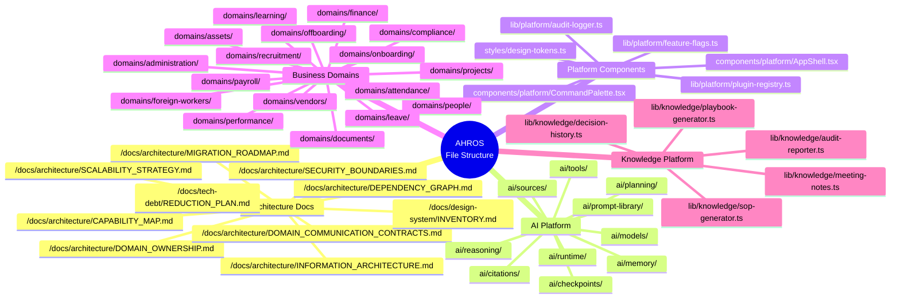
