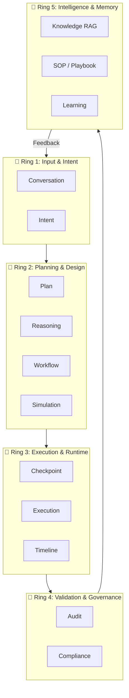
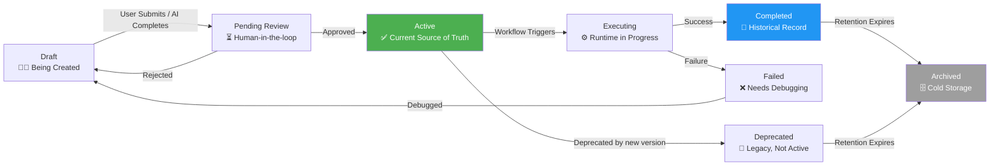
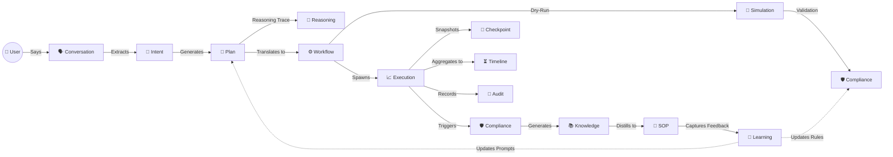
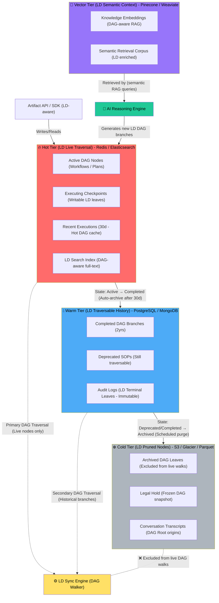
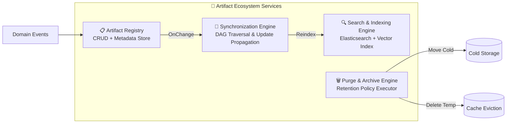

# AHROS Artifact Ecosystem — The Complete Structural Architecture

You have received the **Artifact Data Models**. Now, I present the **Artifact Ecosystem**—the living architecture that governs how these artifacts interact, evolve, store, secure, and synchronize over time.

The ecosystem is not a simple database. It is a **Directed Acyclic Graph (DAG)** of interconnected intelligence, governed by strict lifecycle rules, tiered storage, and event-driven propagation. Think of it as the **nervous system** of the AHROS OS: every action creates a pulse, every pulse creates memory, and every memory is forever linked.

---

## 1. Ecosystem Layer Hierarchy

To understand the ecosystem, we must group artifacts by their role in the operational lifecycle. The ecosystem is partitioned into five logical rings:



---

## 2. The Unified Artifact Lifecycle (State Machine)

Every artifact moves through a universal state machine. This governs **visibility, editability, and synchronization triggers**.



**State Transition Rules:**

| From State | To State | Trigger | Effect on Ecosystem |
| :--- | :--- | :--- | :--- |
| Draft | Pending Review | User clicks "Submit" | Sync Engine freezes dependencies. |
| Pending Review | Active | Human Approves | Artifact becomes globally discoverable; knowledge index updates. |
| Active | Deprecated | Newer version supersedes | Downstream artifacts (SOPs) are flagged for re-sync. |
| Active | Executing | Workflow deployment | Checkpoints become writable; timelines materialize. |
| Executing | Completed | Success | Compliance/Audit finalizes; Knowledge extraction begins. |
| Any | Archived | TTL / Retention Policy | Moved to cold storage; removed from primary search indexes. |

---

## 3. Relationship Topology (The DAG)

This is the **crown jewel** of the ecosystem. Every artifact links to its ancestors and descendants via the `relatedTo` field. The graph is strictly acyclic to prevent infinite propagation loops.

**The Complete Dependency Map:**



**Critical Ecosystem Behaviors enforced by this DAG:**

1.  **Cascade Propagation**: If `Workflow` updates, all `Simulation`, `Execution` (pending), and `SOP` descendants are marked `Deprecated` or `Pending_Review`.
2.  **Immutability of `Completed`**: Once an `Execution` reaches `Completed`, its `Audit` and `Compliance` records become immutable (legal hold).
3.  **Linear History**: A single `Root Event ID` chains everything together, allowing point-in-time reconstruction of any business process.

---

## 4. Versioning & Lineage Strategy

The ecosystem treats change as a first-class citizen.

### 4.1 Semantic Versioning (For Blueprints)
- **Workflows, SOPs, and Plans** use **SemVer (Major.Minor.Patch)**.
  - `Major`: Breaking changes to the business logic.
  - `Minor`: New optional steps or branches added.
  - `Patch`: Bug fixes, UI label changes, or performance updates.

### 4.2 Timestamp Versioning (For Facts)
- **Conversations, Executions, Audits** use **ISO Timestamp + Hash**.
  - These are *observations* of reality. They are never mutated; a new execution creates a new artifact ID.

### 4.3 Branching & Forking
- Users can **fork** an active `SOP` or `Workflow` into a `Draft` to propose improvements.
- The fork automatically inherits `relatedTo` from the parent, allowing the ecosystem to visualize divergence.

---

## 5. Storage Partitioning Ecosystem

To achieve enterprise scalability, the artifact storage is tiered based on access patterns:



---

## 6. Governance & Security Ecosystem

The ecosystem enforces strict governance at the artifact level.

### 6.1 Retention Policies
| Artifact Type | Default Retention | Extendable? |
| :--- | :--- | :--- |
| Conversations / Reasoning | 90 days | Yes (for AI training) |
| Executions / Timeline | 2 years | Yes (Legal Hold) |
| Audit | 7 years (Immutable) | No |
| Compliance | 5 years | No |
| SOP / Knowledge | Permanent | Yes |

### 6.2 Permission Model (RBAC)
Access is controlled via a matrix of `artifact.accessLevel` + User Roles:

| Role | Draft | Active | Audit | Compliance |
| :--- | :--- | :--- | :--- | :--- |
| Employee | View Own | View Own | View Own | View Own |
| HR Manager | Create/Edit | Read/Write | Read | Read/Write |
| Auditor | Read-Only | Read-Only | Read-Only | Read-Only |
| System Admin | Full | Full | Full (Immutable) | Full |
| AI Agent | Create | Read/Write | Create | Create |

---

## 7. Ecosystem Services (The Runtime Components)

The artifact ecosystem is powered by four core background services:



- **Artifact Registry**: The single source of truth API. Validates schemas and enforces versioning.
- **Synchronization Engine**: Listens to `artifact.updated` events, queries the DAG for dependencies, and triggers `regenerate` or `deprecate` actions.
- **Search Engine**: Maintains a unified search index across all Active artifacts. Supports full-text and semantic (vector) search for RAG.
- **Purge Engine**: Runs daily to enforce TTLs, moving cold data to S3 Glacier and deleting expired Checkpoints.

---

## 8. The Developer Ecosystem API (Contracts)

Developers interact with the ecosystem via a unified SDK:

```typescript
// Access the ecosystem
const ecosystem = new ArtifactEcosystem({
  tenant: 'acme-corp',
  user: 'hr-admin',
});

// 1. Fetch the entire lineage of a root event
const lineage = await ecosystem.getLineage('root_event_123');
console.log(lineage);
// Output: { conversation: {...}, intent: {...}, plan: {...}, execution: {...} }

// 2. Fork a production workflow for simulation
const fork = await ecosystem.fork('workflow_456', {
  targetState: ArtifactStatus.DRAFT,
  reason: 'Test high-volume permit renewal',
});

// 3. Resolve a specific version at a specific time (Time-Travel Debugging)
const snapshot = await ecosystem.getSnapshot({
  artifactId: 'sop_789',
  version: 'v1.2.0',
  asOf: '2026-06-01T00:00:00Z',
});

// 4. Re-sync downstream dependencies after a manual edit
await ecosystem.propagate('workflow_456', {
  cascade: true,
  maxDepth: 3, // Limit to prevent runaway propagation
});
```

---

## 9. Resilience & Consistency Guarantees

- **Eventual Consistency**: The Sync Engine uses queues (SQS/RabbitMQ). If `Workflow` updates, downstream `SOPs` may take seconds to regenerate, but the system exposes a `syncStatus` field on the parent artifact.
- **Idempotency**: All artifact writes are idempotent using `id` + `version`.
- **Integrity**: Every artifact stores a `checksum`. The Purge Engine runs a nightly integrity check against the cold store to detect bit-rot or corruption.
- **Circuit Breakers**: If a synchronization loop is detected (cyclic dependency), the Sync Engine halts propagation and alerts the SRE team.

---

## 10. Future-Proofing: The Ecosystem Evolution Path

The ecosystem is designed to scale beyond the initial HRMS scope:

1.  **Extensible Types**: The `ArtifactType` enum is abstract. Plugins can register new artifact types dynamically via the Plugin Registry.
2.  **Event Sourcing Layer**: In Phase 3, we will introduce a complete Event Sourcing layer beneath the Artifact Registry, allowing full replay of any business process.
3.  **Semantic Graph Database**: Once we surpass 10 million artifacts, we will migrate the relationship mapping (`relatedTo`) to a Graph DB (Neo4j) to enable ultra-fast lineage queries (e.g., "What workflows were derived from this SOP?").

---

## 11. Executive Summary of the Ecosystem Structure

To crystallize everything into a single mental model, envision the AHROS Artifact Ecosystem as an **evergreen digital twin** of your organization:

| Structural Element | Description |
| :--- | :--- |
| **Rings** | Logical grouping by purpose (Input → Planning → Execution → Validation → Knowledge). |
| **States** | Universal lifecycle (Draft → Pending → Active → Deprecated → Archived). |
| **DAG** | Strict parent-child links preventing duplicate information. |
| **Tiers** | Tiered storage (Hot: Redis, Warm: PostgreSQL, Cold: S3, Vector: Pinecone). |
| **Governance** | RBAC, Immutable Audit, Retention Policies, Legal Holds. |
| **Services** | Registry (CRUD), Sync Engine (Propagation), Search (Discovery), Purge (Housekeeping). |

---

**Final Directive from the Architect:**

The artifact models define *what* we store. This ecosystem structure defines *how* we store, *where* we store, *how long* we store, and *how* changes ripple. 
